## 2026-10-31 — Широкая главная и проверка продолжения работы

- Главная использует доступную ширину монитора; сетка последних работ меняет число колонок до шести, сохраняя мобильное отображение.
- Для сайтов учитывается действующий общий фон конструктора и приоритет фона блока над страницей; явно отключённый фон не возвращается. Для писем без фото в холсте обложка берётся из готового HTML без логотипов и социальных иконок.
- Восстановление статьи больше не обрывается при запрете браузером чтения правил внешнего CSS. Раннее нажатие «Продолжить работу» ждёт загрузки инструмента; ошибка запуска конструктора выводится пользователю.
- Обновлено руководство по главной и баннерам.

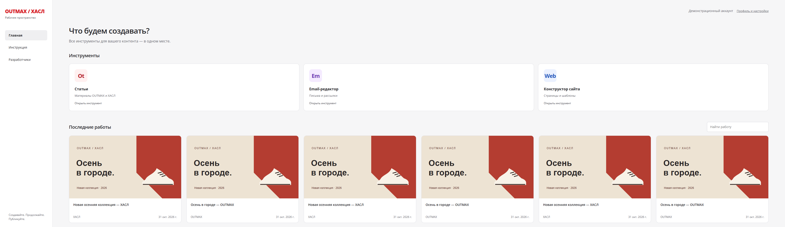
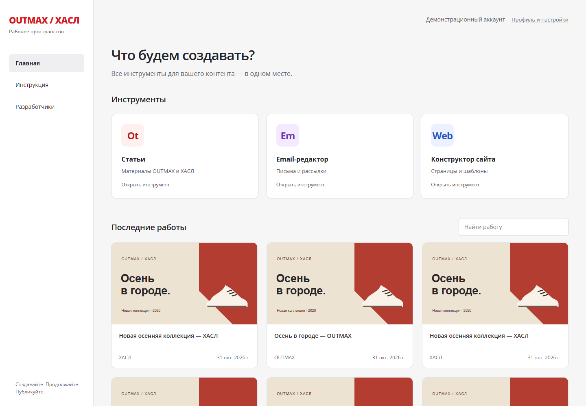
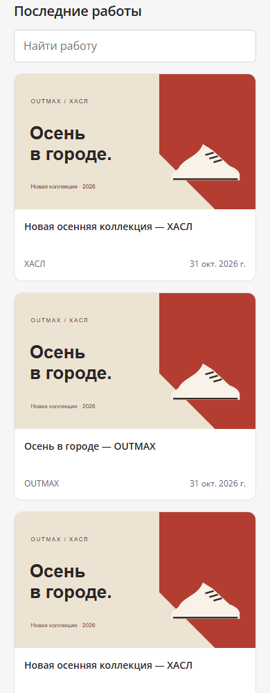

## 2026-10-31 — Продолжение работы с главной и баннеры материалов

- Переход «Главная» дожидается записи локальной копии статьи, письма с изображениями или сайта. «Продолжить работу» открывает последний материал с несохранёнными правками и ждёт завершения восстановления; для статей сохраняется последний бренд.
- Конструктор восстанавливает свою локальную копию после обычного возврата с главной, сохраняя проверку серверной версии и защиту от перезаписи чужих изменений.
- Недавние материалы на главной и в стартовом окне показаны карточками с баннером, названием, брендом и датой. При отсутствии или ошибке обложки появляется заглушка. Просмотр не загружает изображения на сервер повторно и не меняет оригиналы.
- Обновлено руководство по главной и продолжению работы.

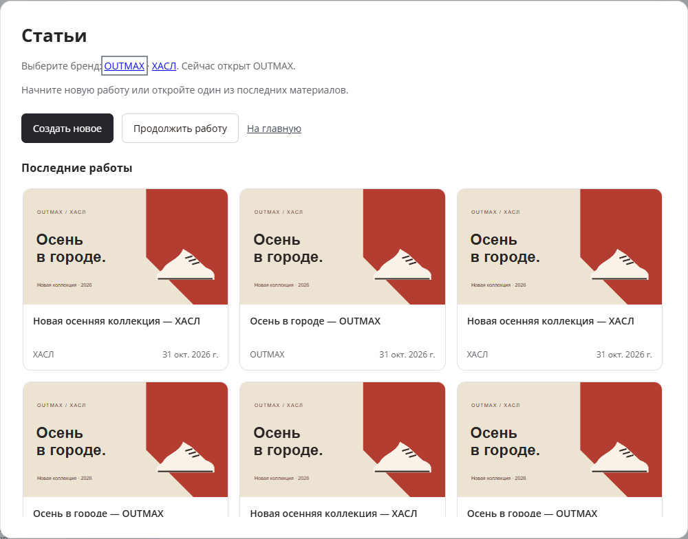

## 2026-10-31 — Главная, старт инструментов и продолжение работы

- Добавлена главная в духе Adobe: три инструмента — статьи, email и конструктор — и личные последние работы с поиском. Бренды OUTMAX и ХАСЛ выбираются внутри статей.
- При входе в инструмент открывается выбор: новый материал, продолжение работы или недавний документ. Прямые ссылки открывают материал сразу, обновление вкладки сохраняет рабочий контекст.
- Конструктор восстанавливает локальные несохранённые правки с защитой от перезаписи изменившейся серверной версии. Статьи и email используют существующие резервные копии; добавлена поддержка прямой ссылки на email-проект.
- В инструкции добавлены руководство по главной и раздел «Разработчики и инструменты»: Иван Радыгин со ссылкой на профиль, инструменты разработки и технологии проекта.

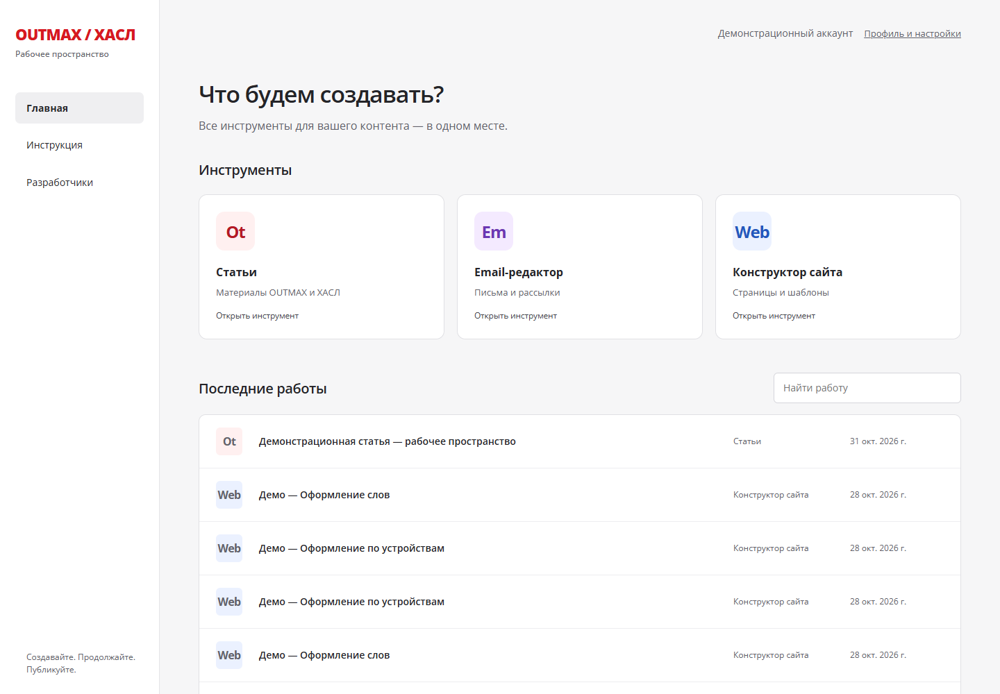
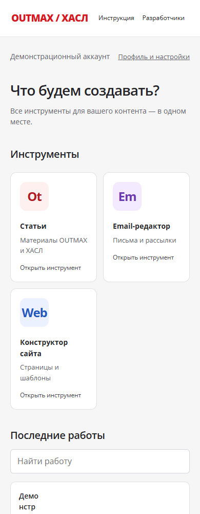
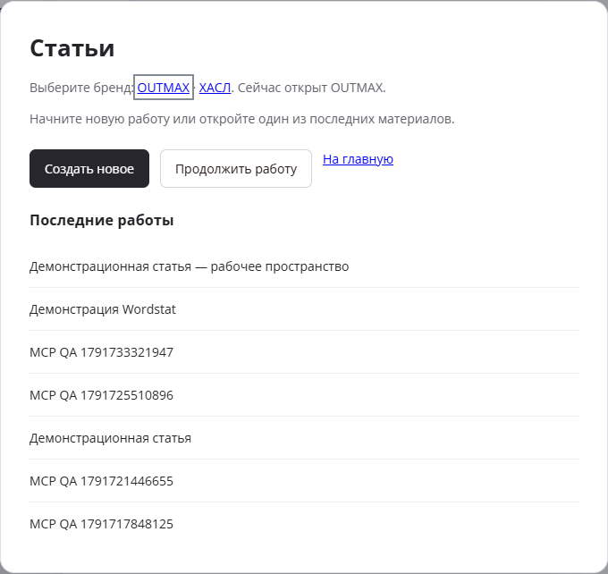

## 2026-10-31 — Прямые ссылки на фотографии и иконки инструментов

- Экспорт HTML публикует оригиналы фотографий на сервере без сжатия и вставляет постоянные прямые ссылки. ZIP содержит HTML без папки изображений.
- Инструменты форматирования статьи получили локальные SVG Phosphor, включая разные иконки выравнивания слева, по центру и справа.
- Обновлены руководство экспорта и проектные навыки с правилами автоматического применения. GSAP и Vanta указаны как библиотеки для задач анимации.

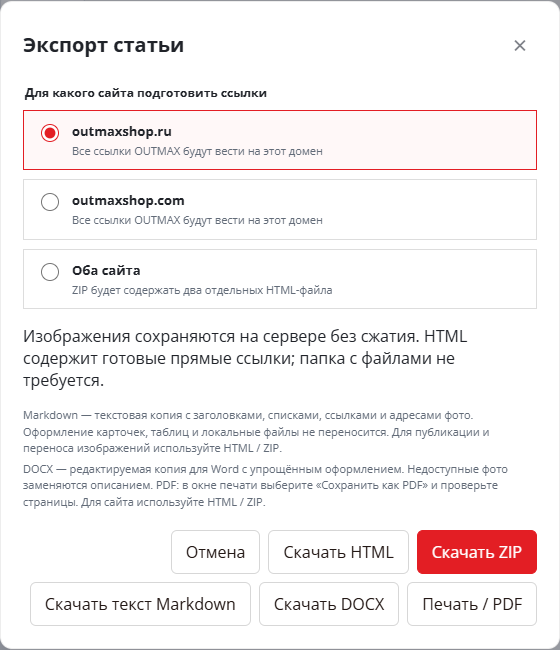
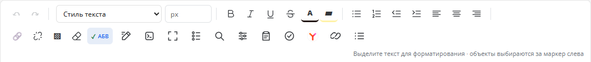

## 2026-10-28 — Общие и телефонные настройки выделенных слов

- Цвет, размер, жирность и подложка, изменённые в компьютерном превью, применяются на всех устройствах. Изменения в телефонном превью действуют только на телефоне.
- Правка отдельного свойства на компьютере заменяет телефонную настройку этого свойства у выбранных слов, сохраняя остальные телефонные настройки. Панель явно показывает область применения.
- «Снять оформление» на телефоне возвращает наследование от компьютера; на компьютере снимает оформление выбранных слов везде. Настройки сохраняются в проекте и адаптивном HTML.
- Обновлена инструкция «ХАСЛ: оформление выделенных слов».

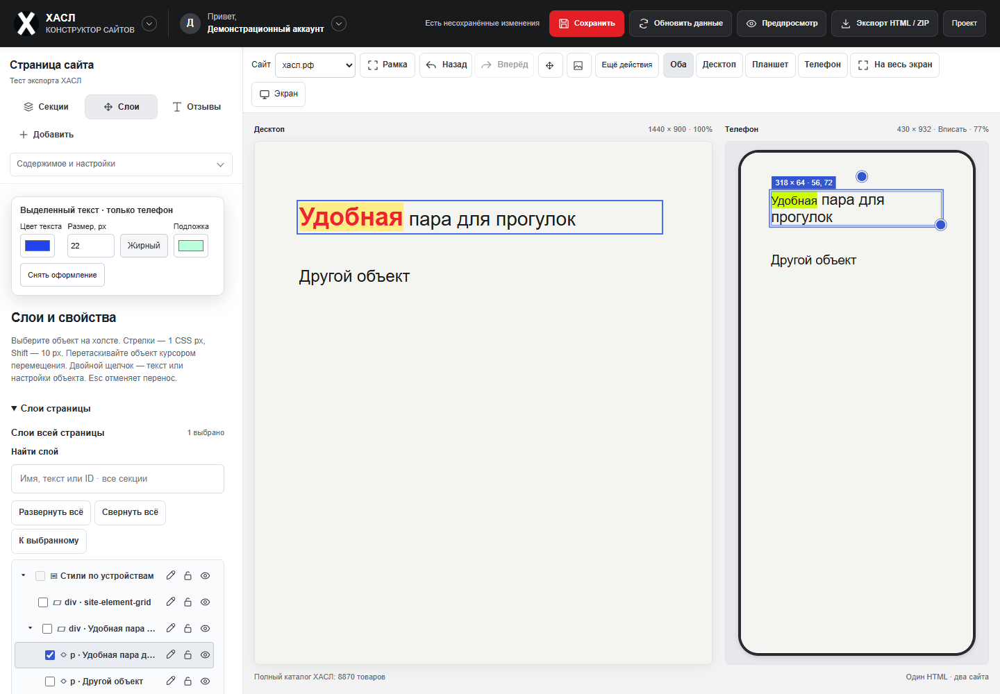

## 2026-10-28 — Оформление отдельных слов в конструкторе

- У выделенных слов можно отдельно менять цвет текста, размер шрифта 8–200 px, жирность и цветную подложку. Панель «Выделенный текст» появляется в свойствах, на телефоне — внизу экрана.
- Снятие оформления затрагивает только выделенные слова. Остальной текст и ссылки сохраняются; щелчок по другому объекту по-прежнему завершает редактирование и выбирает его.
- Оформление сохраняется в проекте и экспорте HTML, работает с существующей отменой/повтором и обновляет оба превью.

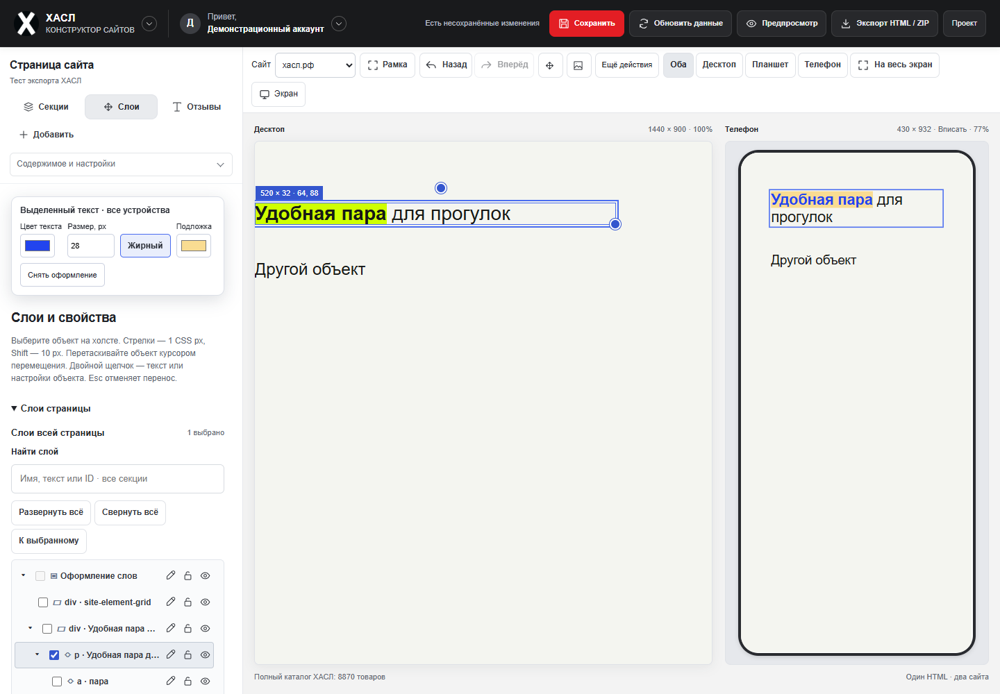
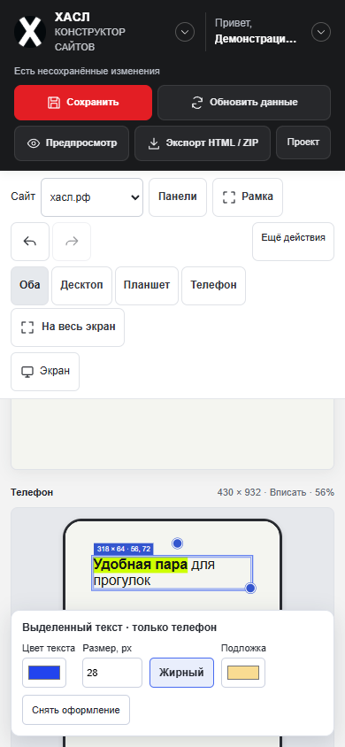

## 2026-10-28 — Выделение слов мышью в конструкторе

- Щелчки и движения мыши внутри редактируемого текста обрабатываются как обычное выделение слов. Они больше не переключают панель на элементы и не запускают перенос блока.
- Двойной щелчок внутри редактируемой надписи выделяет слово. Один щелчок по другому объекту завершает ввод и сразу выбирает этот объект.

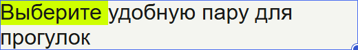

## 2026-10-28 — Архив шаблонов, выделение объектов и стрелки кнопок

- При первом ручном сохранении шаблона запрашивается «Имя файла». Имя можно изменить отдельно от текста, SEO-заголовка и адреса страницы; оно используется и для резервной JSON-копии.
- Архив шаблонов оформлен как архив статей: белое окно, поиск, фильтр магазина, карточки или список, группировка по месяцам, даты, переименование и копирование. Удаление из архива можно отменить.
- Перенос объекта начинается после небольшого движения и показывает курсор перемещения. Escape отменяет перенос. Двойной щелчок редактирует текст или открывает свойства объекта.
- Выделение при редактировании ограничено текущим текстом. Ctrl+A не захватывает всю страницу, щелчок по другому объекту завершает ввод и выбирает его.
- У кнопок добавлены «Показать иконку» и три направления стрелки: вправо, вверх-вправо и вниз-вправо. Настройки сохраняются в проекте и экспорте HTML.

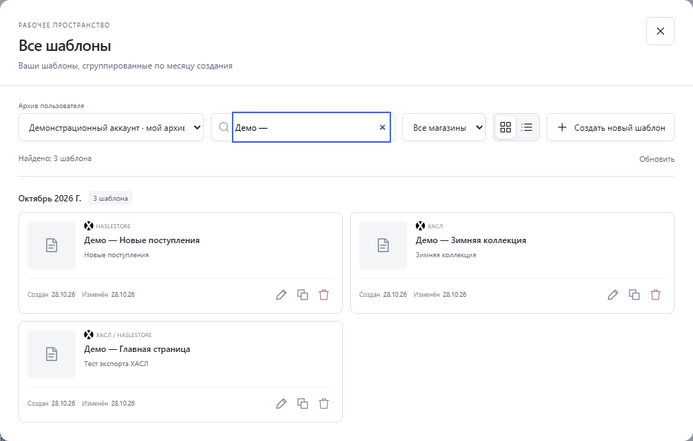
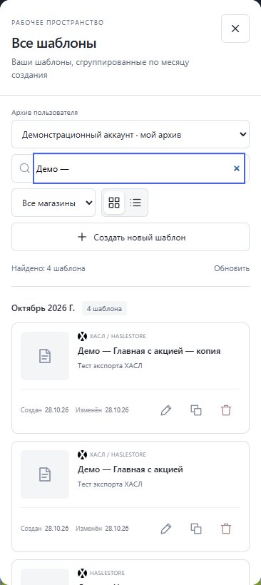
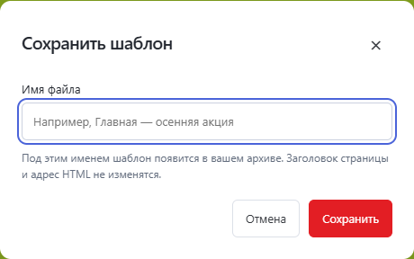
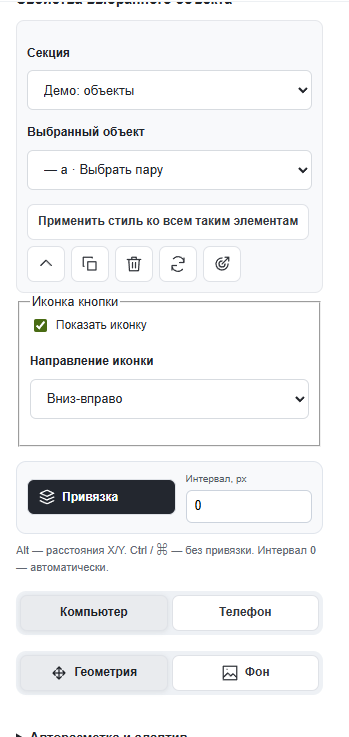
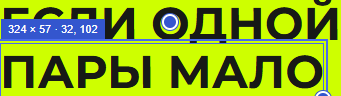

## 2026-10-28 — Тексты первого экрана ХАСЛ

### Изменено
- В шаблоне на телефоне и десктопе: «ГЛАВНАЯ АКЦИЯ», «ЕСЛИ ОДНОЙ ПАРЫ МАЛО», «2-Я ПАРА -50%»; в подборе — «БЫСТРЫЙ ПОДБОР», «ВЫБЕРИ СВОЮ ПАРУ ЗА 15 СЕКУНД», «НАЧАТЬ».
- Кнопка акции открывает статью о скидке на вторую пару на выбранном магазине. Существующие изображения и настройки фона первого блока сохранены.

## 2026-10-27 — Автоматические вкладки брендов, подбор и плавный FAQ

### Изменено
- Поля сезона и бренда выровнены на телефоне. Добавлены поиск со значком лупы и ограниченная прокрутка списка; выбор сохраняется при поиске. Бренды подбора берутся из полного фида только по обуви в наличии (68 при проверке), идентификаторы подтверждаются магазином.
- Экспорт полного шаблона и страница ZIP проверены внешними сервисами: Schema.org Validator — нет ошибок и предупреждений; Google Rich Results Test — 9 элементов без критических ошибок, остаются рекомендации по необязательным полям.
- Проверена микроразметка обновлённого шаблона: Product и FAQPage сохраняют содержание при фильтрации и анимациях; JSON-LD совпадает в HTML и ZIP, ссылки соответствуют выбранному магазину.
- Вкладки брендов над товарами автоматически строятся по товарам конкретной витрины. Новый бренд добавляет вкладку, удаление последнего товара бренда убирает её. Повторы не создают лишних вкладок, отдельные блоки независимы, сезонные фильтры сохраняются.
- В шаблоне подбора по размеру поле «Бренд» позволяет отметить несколько брендов галочками без Ctrl. Ссылка «Найти свою пару» учитывает все выбранные бренды вместе с размерами и сезоном на обоих магазинах. «Любой бренд» сбрасывает только бренды.
- FAQ на телефоне плавно раскрывается и сворачивается за 220 мс. Быстрое повторное касание меняет направление; клавиатура и уменьшение движения переключают ответ сразу. Поведение одинаково в предпросмотре, полном HTML и фрагменте CMS.

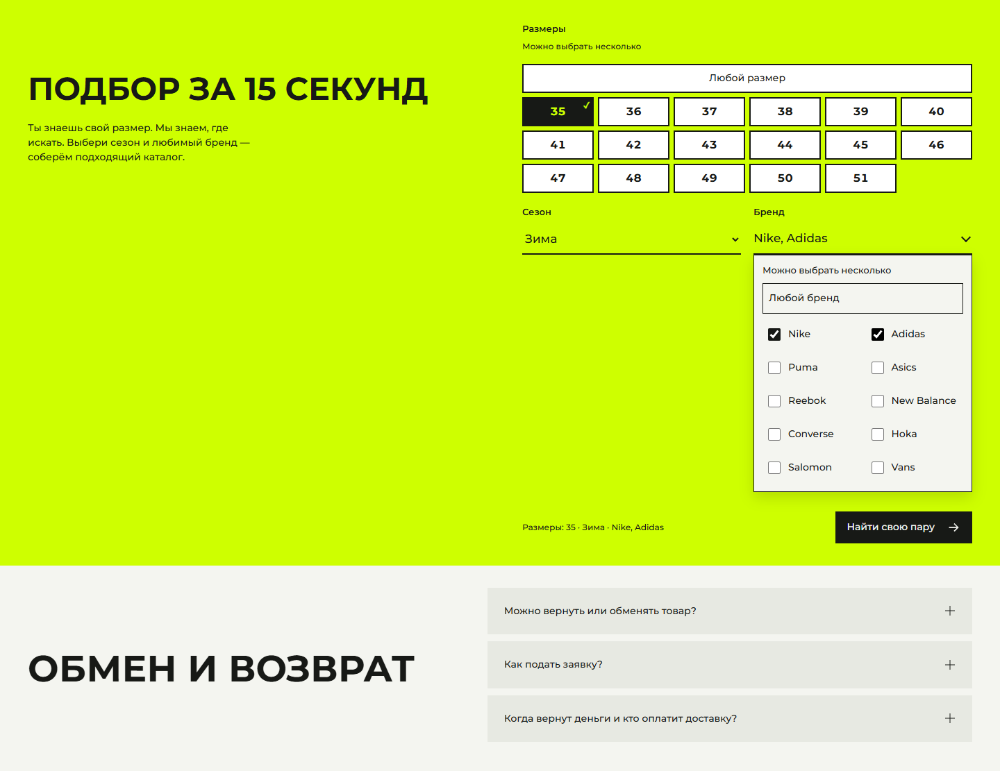
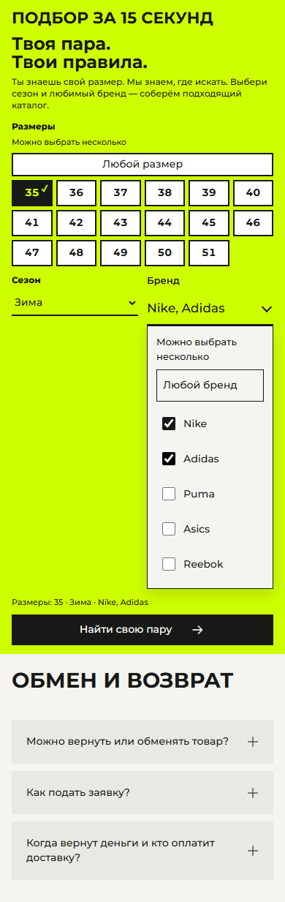
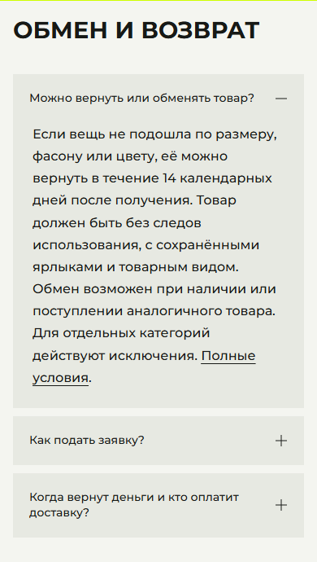
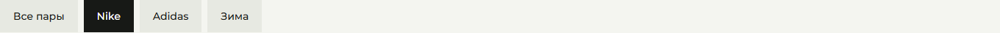
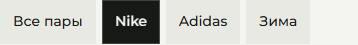

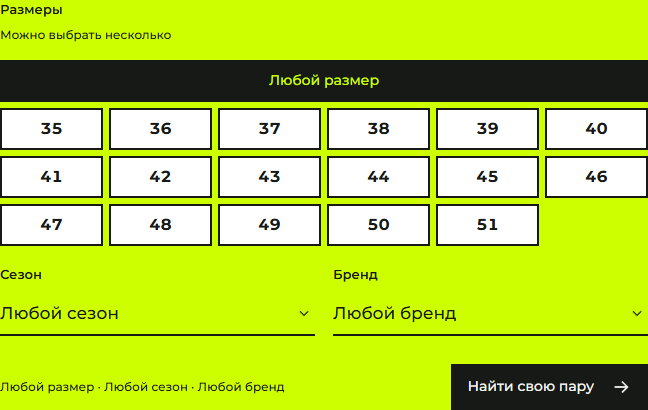
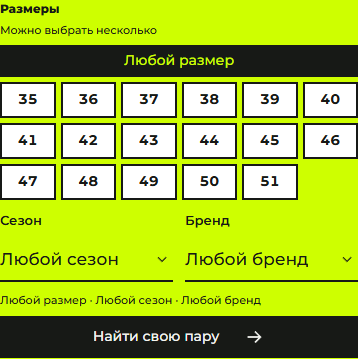
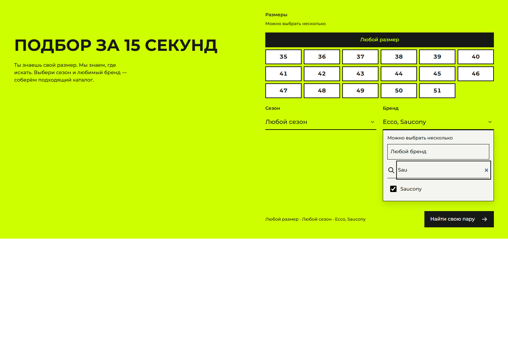
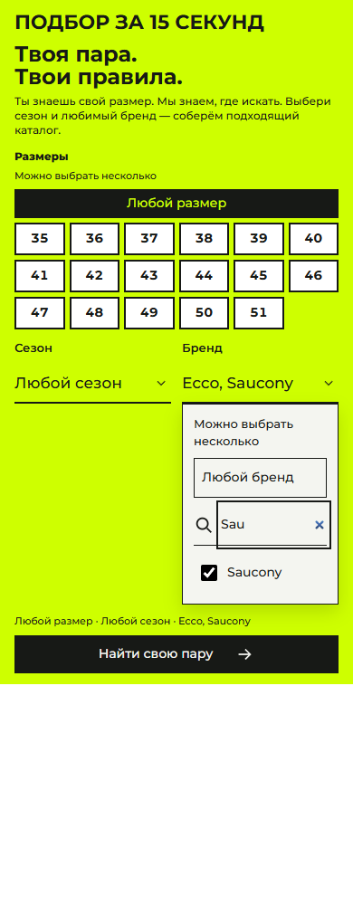
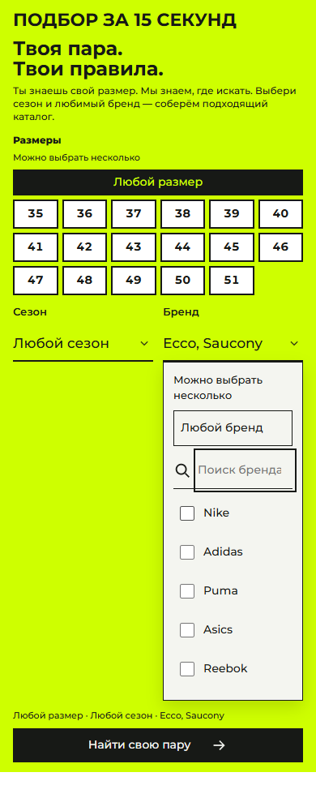

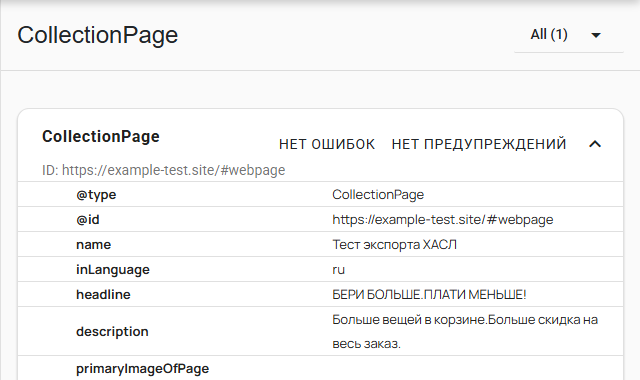

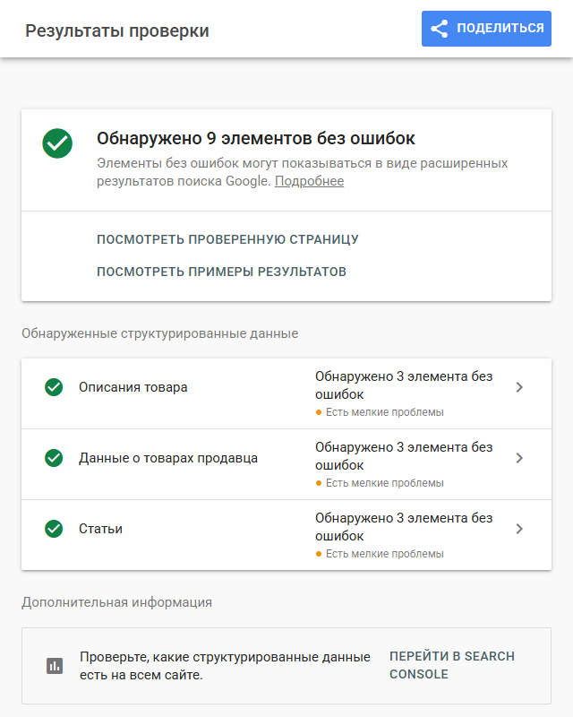

## 2026-10-26 — Мобильный runtime: производительность прежде анимаций

### Добавлено
- Автоматические HIGH, BALANCED и LITE по доступным сигналам устройства и коротким фактическим наблюдениям во время взаимодействий; без определения мощности по модели или ширине.
- Лёгкий пружинный отклик через transform/opacity, сжатие/растяжение и небольшой отскок в HIGH. Без тяжёлой библиотеки и глобального will-change. Собственный необязательный модуль подгружается только при касании элемента управления; LITE и сокращение движения его не запрашивают.

### Изменено
- На мобильном FAQ высота больше не анимируется. Управление отвечает сразу; длинный ответ перестраивается после первого отклика. Планшет и компьютер сохраняют прежнее поведение.
- Декоративные эффекты прекращаются вне видимой области и в скрытой вкладке; сокращение движения и клавиатура работают без ожидания анимации.
- При недоступности модуля эффектов страница сохраняет простой отклик и все основные действия; стартовая загрузка не ждёт модуль.

### Исправлено
- Убраны повторные синхронные чтения геометрии из обработчиков касания; на изначально ограниченных устройствах LITE не устанавливает обработчики пружин и наблюдатели кадров.
- При длинных задачах и пропусках кадров необязательные эффекты автоматически упрощаются без отключения FAQ, ссылок, фильтров и отзывов.
- Выполнены воспроизводимые Lighthouse/DevTools-проверки «до/после». Цели 90+, LCP ≤ 2,5 с и аппаратные 60/120 FPS не заявлены достигнутыми: ограничения измерений и текущие показатели записаны в общем QA-отчёте.

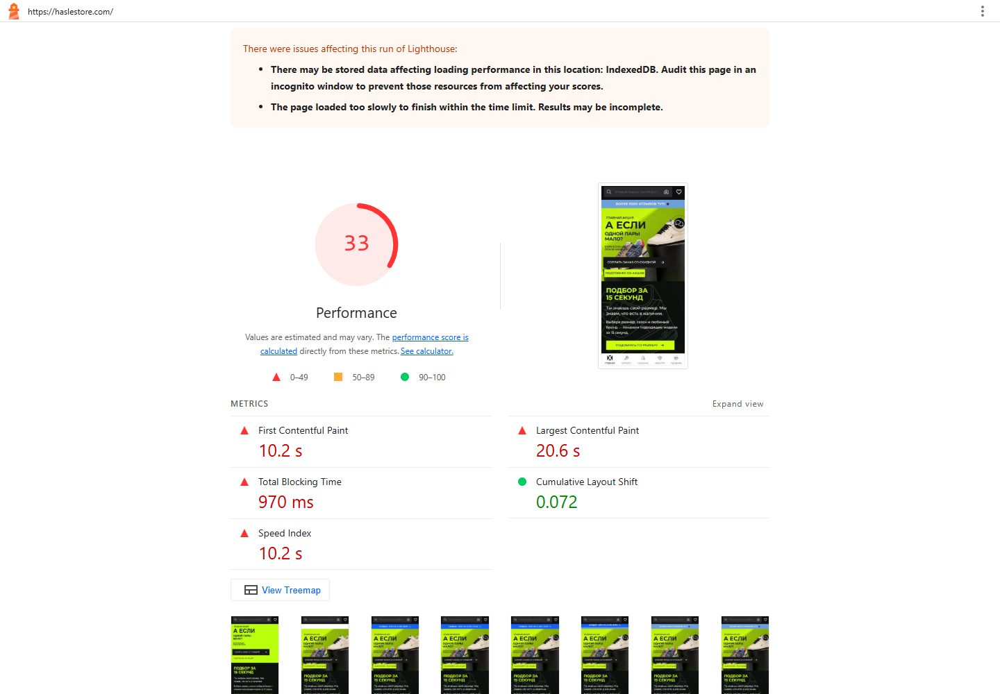
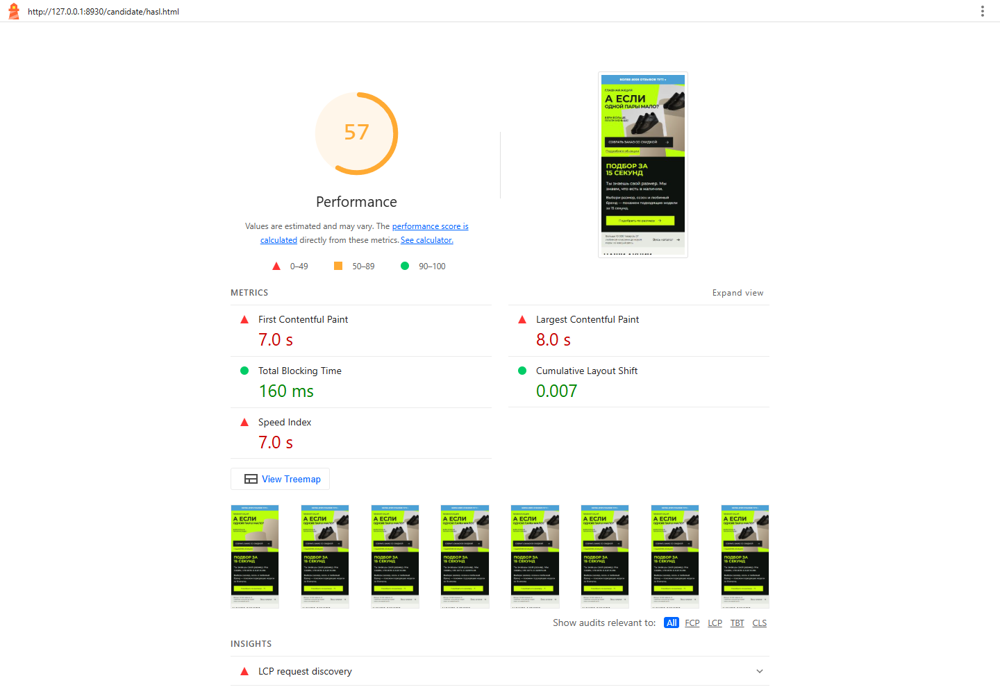

## 2026-10-26 — В ченжлоге отображаются списки изменений

### Добавлено
- Текстовые категории «Добавлено», «Изменено» и «Исправлено» перед скриншотами; содержание списков участвует в поиске.

### Изменено
- Обновлены описания текущих изменений конструктора: FAQ, прелоадер, сохранение экрана и каталог устройств.

### Исправлено
- Обычные абзацы из старых записей CHANGELOG.md больше не теряются при сборке страницы инструкций: они также показываются текстовым списком.
- Дни по-прежнему объединяются автоматически; отдельная копия истории не создаётся.

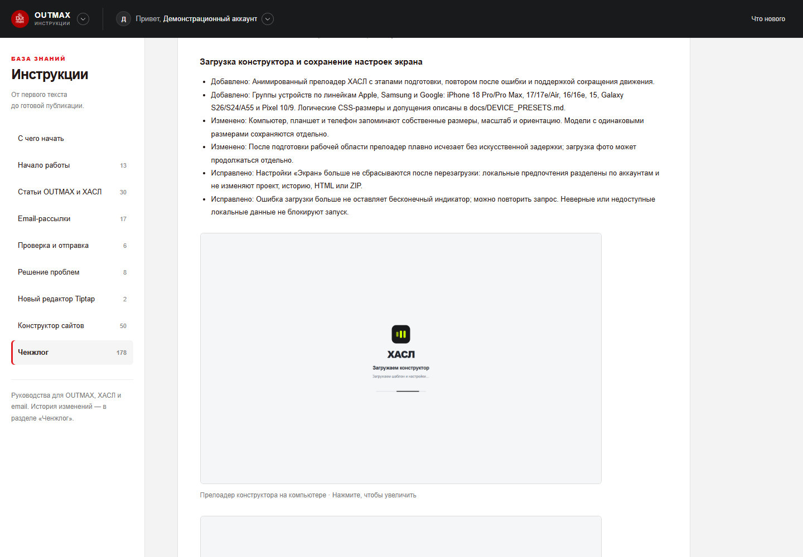
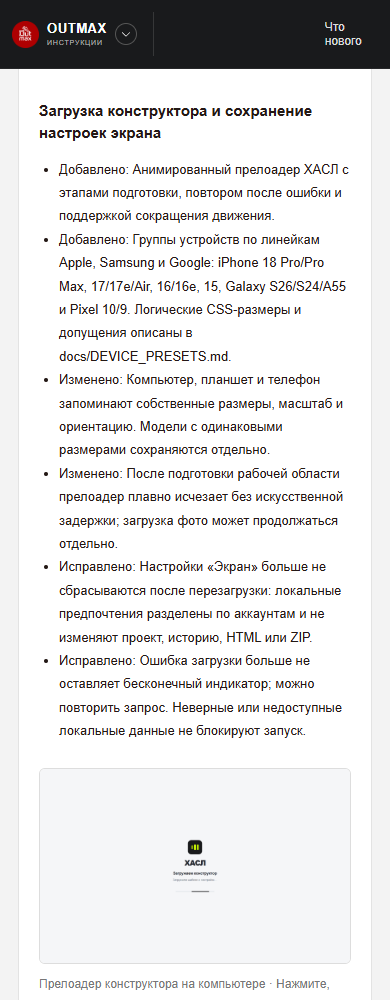

## 2026-10-26 — Загрузка конструктора и сохранение настроек экрана

### Добавлено
- Анимированный прелоадер ХАСЛ с этапами подготовки, повтором после ошибки и поддержкой сокращения движения.
- Группы устройств по линейкам Apple, Samsung и Google: iPhone 18 Pro/Pro Max, 17/17e/Air, 16/16e, 15, Galaxy S26/S24/A55 и Pixel 10/9. Логические CSS-размеры и допущения описаны в docs/DEVICE_PRESETS.md.

### Изменено
- Компьютер, планшет и телефон запоминают собственные размеры, масштаб и ориентацию. Модели с одинаковыми размерами сохраняются отдельно.
- После подготовки рабочей области прелоадер плавно исчезает без искусственной задержки; загрузка фото может продолжаться отдельно.

### Исправлено
- Настройки «Экран» больше не сбрасываются после перезагрузки: локальные предпочтения разделены по аккаунтам и не изменяют проект, историю, HTML или ZIP.
- Ошибка загрузки больше не оставляет бесконечный индикатор; можно повторить запрос. Неверные или недоступные локальные данные не блокируют запуск.

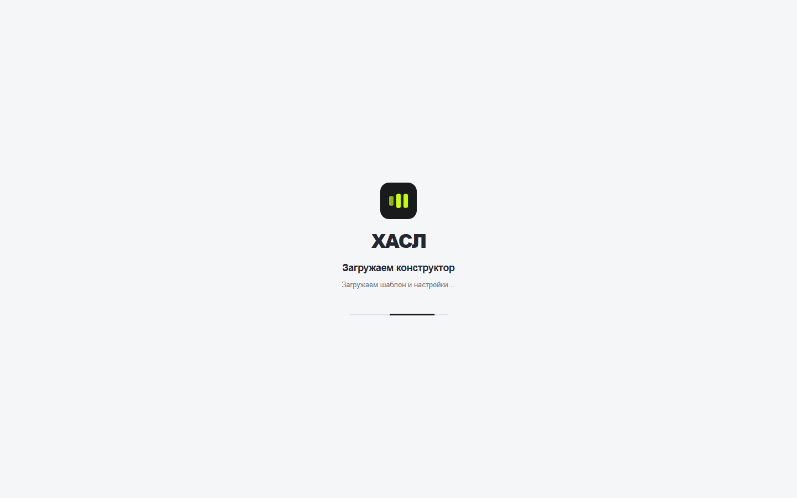
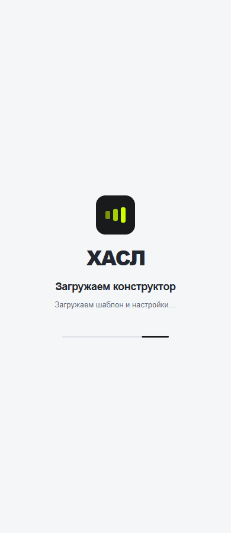
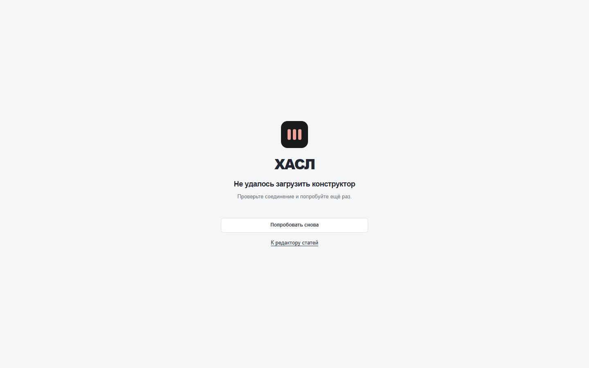
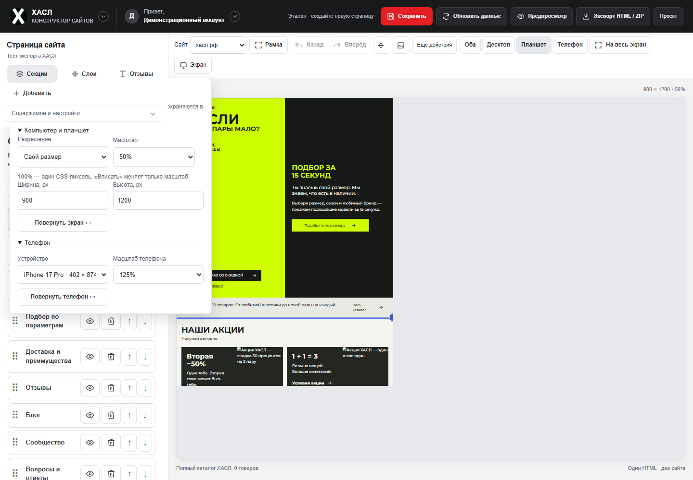
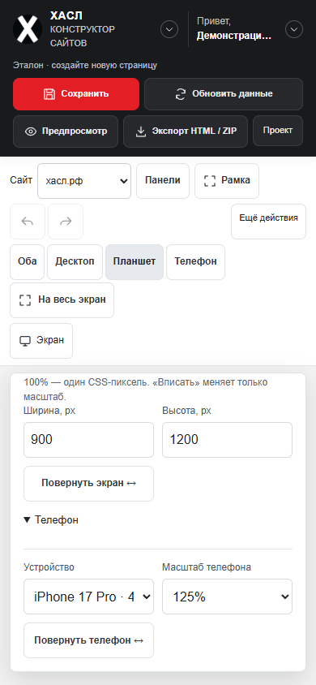

## 2026-10-26 — Настройки раскрытия FAQ и положение заголовка

### Добавлено
- В свойствах блока «Вопросы и ответы» появился раздел «Раскрытие FAQ»: все ответы закрыты или первый открыт при загрузке; несколько ответов одновременно или только один.
- Выбор положения заголовка: сбоку слева, сбоку справа либо сверху. На телефоне заголовок всегда над вопросами.

### Изменено
- На компьютере ответы раскрываются плавно, боковой заголовок следует за центром списка. Быстрый повторный клик меняет направление движения.
- Клавиатура и системное сокращение движения работают без декоративной задержки. Начальные настройки переносятся в HTML, CMS-фрагмент и ZIP.

### Исправлено
- Явно закрытый первый ответ остаётся закрытым при перерисовке холста. Новые начальные настройки применяются при их изменении.
- Закрытые ответы сохранены в FAQ-разметке для поисковых систем, а их ссылки исключены из клавиатурного обхода до открытия.

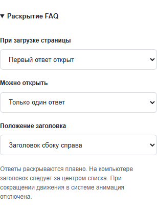
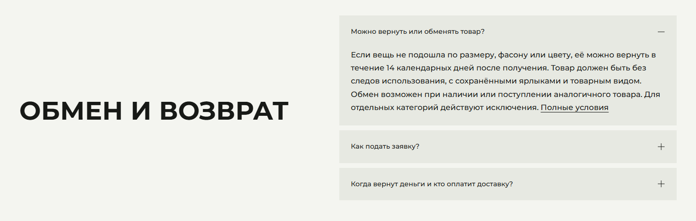
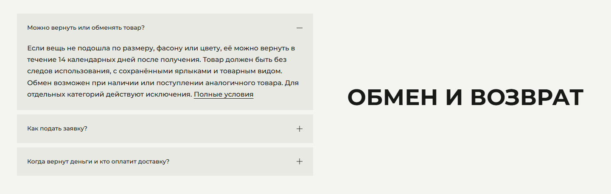
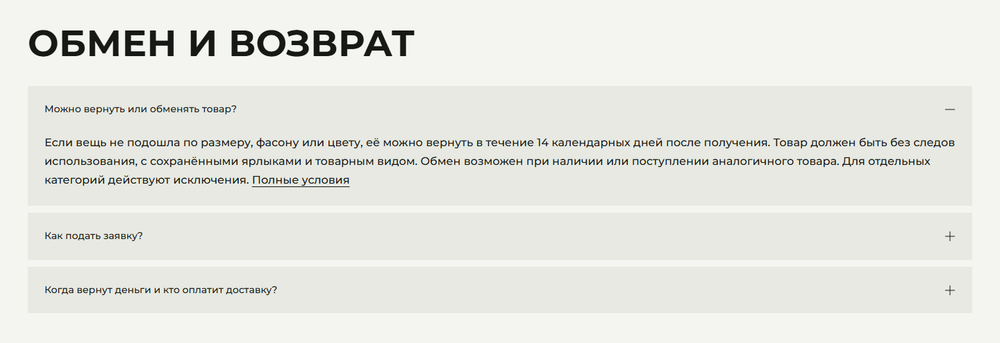
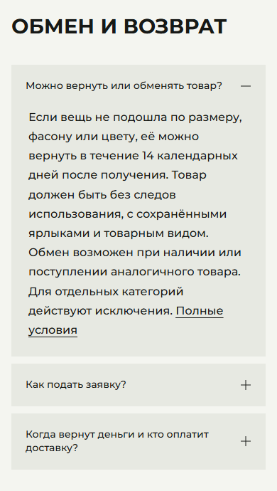

## 2026-10-26 — Редактирование раскрытых ответов FAQ

Вопросы раскрываются прямо на холсте редактора. Ответ можно изменить двойным нажатием, а в выделенный текст вставить ссылку через Ctrl+K. Раскрытие сохраняется при обновлении текущего холста, отдельно для компьютера и телефона; в экспорт не записывается.

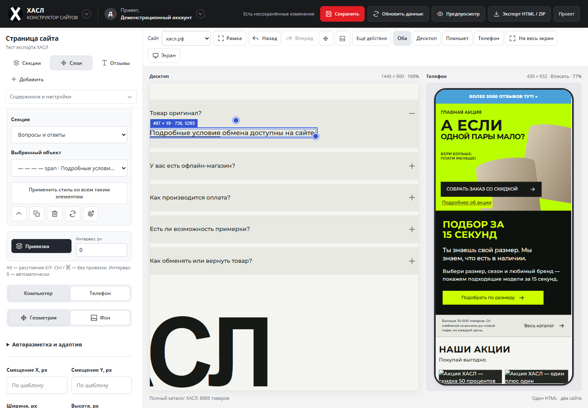

## 2026-10-26 — Заголовок над акционными карточками

«Наши акции» и «Покупай выгодно» перенесены над двумя акционными карточками на компьютере и телефоне. Исходная товарная подборка под акциями убрана. Старые проекты переносят свои тексты заголовка при открытии; дополнительные экземпляры подборок сохраняются.

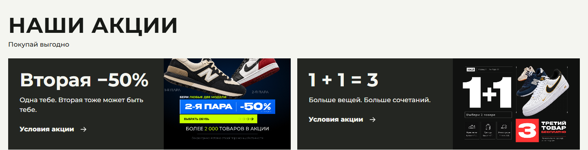
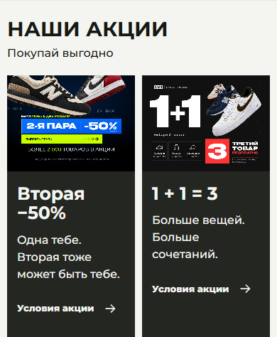

## 2026-10-26 — Заголовок обмена и возврата по центру

На компьютере заголовок располагается по вертикальному центру списка вопросов и сохраняет центрирование при раскрытии ответов. На телефоне остаётся над вопросами.

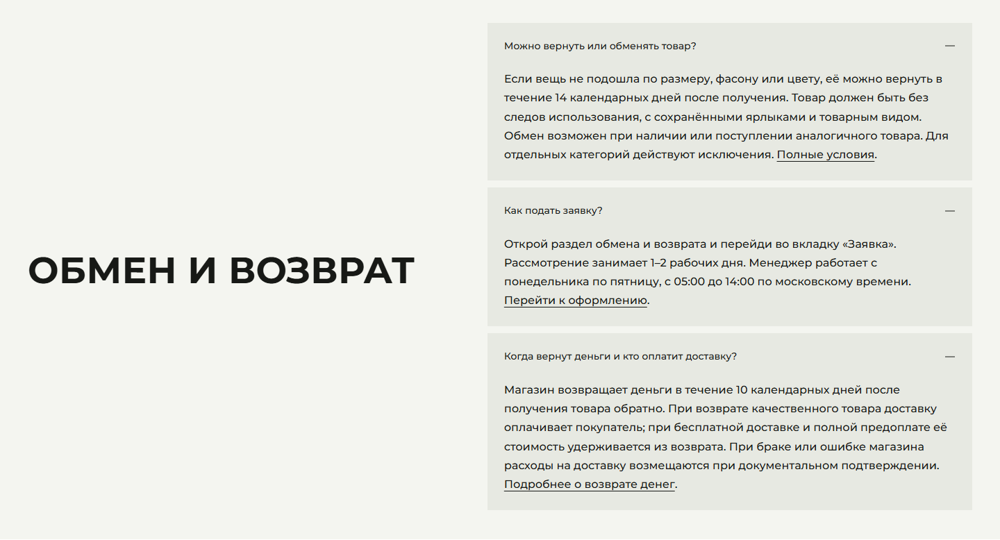
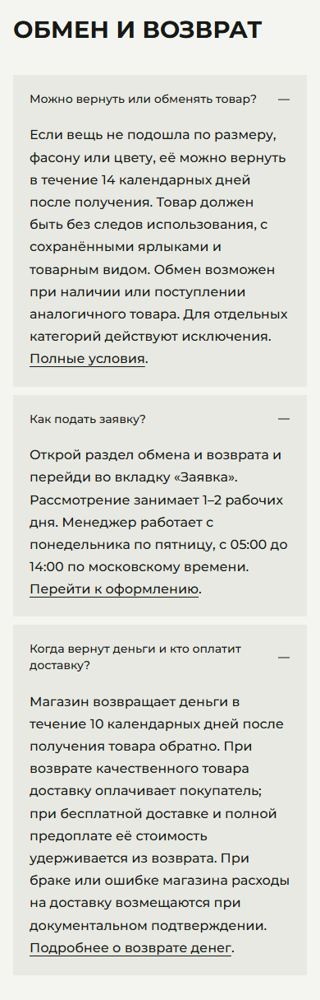

## 2026-10-26 — Отдельный акционный блок и отзывы своего магазина

Две карточки под первым экраном выделены в «Акционный блок»: отдельные перемещение, видимость, фон, тексты, ссылки и изображения. Старые проекты получают блок автоматически с сохранением правок исходных карточек; удаление не вызывает повторного добавления.

HTML, CMS-фрагмент и ZIP подготавливают отзывы и новости выбранных магазинов. Универсальный экспорт выбирает свой снимок по домену до запуска интерактивности. Недоступный источник останавливает подготовку вместо подстановки отзывов другого магазина. Ранее опубликованный HTML требуется заменить новым.

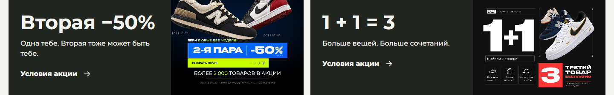

## 2026-10-26 — FAQ, мобильный баннер и стрелки подборок

- Значок FAQ больше не дублируется текстовым плюсом из-за общего шрифта кнопок; раскрытый вопрос показывает один минус.
- Содержимое зелёного баннера использует собственные мобильные смещения X/Y. Если они не заданы, сохраняется исходная мобильная позиция; явно заданные значения телефона не сбрасываются.
- Сохранены переносы строк текстовых полей при очистке HTML для экспорта/CMS. Исправления старой страницы магазина проверены локально в браузере; её опубликованный HTML не меняется при деплое конструктора.

- Ссылка «Все модели» выровнена со стрелками подборки на компьютере и телефоне.

## 2026-10-26 — Совпадение редактора и предпросмотра

- Предпросмотр использует размеры выбранного экрана редактора; изменение окна меняет масштаб, а не расположение объектов. В заголовке показано разрешение, добавлено обновление просмотра и сообщение при ошибке.
- Высота главного баннера больше не зависит от высоты окна: перемещённые кнопки не прыгают относительно текста. Мобильная раскладка сохранена.
- Montserrat встроен в шаблон: внешняя таблица Google Fonts больше не задерживает отображение и не вызывает расхождение метрик текста. Быстрое повторное открытие не очищается отложенным событием закрытия.

## 2026-10-26 — Стабильное редактирование и фон главного баннера

- Холст не пересоздаётся во время ввода свойств, работы со списком элементов и перетаскивания. Геометрия меняется на месте, отложенное обновление выполняется после завершения действия.
- Убран пересчёт позиции фоновой картинки относительно окна при прокрутке: зелёный баннер сохраняет кадрирование внутри своих границ на компьютере и телефоне.

## 2026-10-26 — Ссылки в редакторе снова показывают адрес

- На обоих холстах конструктора ссылки и якоря показывают чёрное уведомление с адресом вместо перехода, в том числе внутри редактируемого текста. Учтены Ctrl+клик, средняя кнопка и Enter.
- Обычный и публичный предпросмотр сохраняют рабочие переходы и попапы. Содержимое проекта не меняется при проверке адреса.

## 2026-10-26 — Фоны всех блоков, общие стили и компактный подбор

- У каждого блока доступны фон с отдельной папкой загрузок, положение, масштаб, поворот, отражение, непрозрачность и заливка цветом или градиентом для компьютера и телефона.
- Глобальные стили карточек, текстов, попапов, кнопок и заголовков применяются внутри текущего сайта; содержание карточек сохраняется. Используется существующая история отмены.
- Список личных шаблонов, создание из эталона, пустой сайт и отдельная копия перенесены в профиль.
- Исправлена растянутая ширина кнопок баннеров. Добавлены индивидуальная ширина и горизонтальные/вертикальные отступы для обеих версий, в том числе у объектов.
- Пол убран из подбора. На десктопе подбор расположен в две колонки, размеры — по шесть в ряд. Подзаголовки менее жирные, имя и дата отзыва компактнее и в одну строку.

## 2026-10-26 — Главная акция и единые прямоугольные кнопки

Баннер повторяет предоставленную раскладку: короткие тексты, основная кнопка и ссылка на подробности; своя фоновая картинка сохранена и размещается внутри баннера. Одинаковая информация на компьютере и телефоне. У текстовых кнопок и ссылок-действий единая типографика Montserrat 14 px / 500, без сильной жирности. Стрелки каруселей, избранное и остальные кнопки имеют прямые углы.

## 2026-10-26 — Десктопный попап и реальное число отзывов

В полном отзыве на компьютере фото с миниатюрами размещены слева, имя, дата, город, оценка и текст — справа. Закрытие и навигация сохранены. На телефоне информация остаётся последовательной. Заголовок отзывов и карточка «Смотреть все» используют реальный итог выбранного магазина; при отсутствии данных фиксированное число не подставляется.

## 2026-10-26 — Переключение магазинов и дата показателей

В панели конструктора и окне предпросмотра доступен выбор ХАСЛ / HASLESTORE. Для каждого магазина загружаются собственные отзывы и новости, показатели и ссылки; каталог товаров остаётся общим XML. Кэш источников и ID HASLESTORE разделены, ошибки загрузки не подменяют его контент данными другого магазина. Числа преимуществ зелёные без жирного начертания на всех экранах; наведение или фокус на компьютере показывает дату последнего успешного обновления.

## 2026-10-26 — Город и звёзды в полном отзыве

В полном отзыве на телефоне и компьютере отображаются город и оценка из данных отзыва. При переключении отзывов данные обновляются. Карточки больше не подставляют пять звёзд всем отзывам; отсутствующие город и оценка скрыты. Старые публичные копии нужно обновить через удалённый предпросмотр.

## 2026-10-26 — Устройства и комментарии в публичном просмотре сайта

Добавлены режимы «Оба», «Десктоп», «Телефон» с настоящей шириной 1440/390 px и масштабированием. Подключены существующие обсуждения статей: заметки к месту, ответы, отметка «Решено», права автора и входящие владельца. Просмотр доступен без входа, комментарии — после входа. В конструкторе появились «Комментарии» в предпросмотре, боковой панели и профиле. Снимок сайта остаётся изолирован от аккаунта и не отправляет аналитику.

## 2026-10-26 — Подписи отзывов, читаемые заголовки и переходы в преимуществах

На телефоне имя и дата отзыва стоят отдельными строками, звёзды — ниже. Заголовки шаблона получили вес 700 и обычный межбуквенный интервал на всех устройствах. В пяти карточках преимуществ добавлены ссылки «Перейти»: каталог, главная, каталог, отзывы, статья об оплате долями. Адреса учитывают ХАСЛ/HASLESTORE и универсальный экспорт.

## 2026-10-26 — Возвращена видимая кнопка обновления данных конструктора

«Обновить данные» снова находится в верхней панели рядом с сохранением, а не внутри меню «Проект». Подпись видна на компьютере и телефоне; иконка сохраняется во время и после загрузки. На узком экране кнопки переносятся без наложения текста. Обновление использует существующий механизм и сохраняет ручные правки; после ошибки можно повторить запрос.

## 2026-10-26 — Общие счётчики Яндекс и Google, реальные показатели магазинов

В настройках страницы появились общие ID Метрики и Google Analytics отдельно для ХАСЛ и HASLESTORE. В кнопках достаточно цели или имени события. Настройки сохраняются в шаблоне; старые цели совместимы. Подключение аналитики в HTML включается отдельно, предпросмотр не отправляет события.

Блок преимуществ получает раздельные числа моделей кроссовок и отзывов каждого магазина. Кеш обновляется раз в шесть часов при обращении, последнее успешное число сохраняется при ошибке источника. Мобильный блок стал контрастным: лаймовые ячейки и чёрные иконки.

## 2026-10-26 — Фирменные цвета мобильных преимуществ

- Мобильные преимущества получили лаймовые ячейки с чёрными иконками и тёмные ячейки со светлым текстом. Ключевые числа и подзаголовок выделены лаймом.
- Общие тексты, шахматное расположение, крупные иконки и десктопное оформление сохранены.

## 2026-10-26 — Личный список шаблонов конструктора

- «Мои шаблоны» доступны отдельной кнопкой в левой панели. Сохранение обновляет список; можно открыть шаблон, создать страницу из эталона или отдельную копию.
- Используется существующее серверное хранилище аккаунта и история версий. Проверено, что список и открытие чужих шаблонов недоступны.

## 2026-10-26 — Яркие преимущества и понятные кнопки

- Десктопные преимущества оформлены пятью контрастными карточками на тёмном фоне: крупные светлые иконки, читаемые заголовки, лаймовые акценты.
- Основные кнопки акции одинакового размера. «Подробнее об акции» удалена на ПК и телефоне; тексты условий показаны сразу.
- Кнопка «Редактирование» убрана из панели, у основной кнопки «Предпросмотр» появилась иконка глаза.

## 2026-10-26 — Компактная мобильная лента и преимущества ХАСЛ

- На телефоне две с половиной карточки отзывов: уменьшены фото, шрифты, звёзды и отступы. Полный текст остаётся доступен по кнопке; на десктопе четыре карточки.
- Мобильные преимущества используют общие с десктопом тексты и крупные иконки в шахматном порядке. Убран лишний чёрный отступ снизу.
- Знаки раскрытия вопросов выполнены тонкими линиями; открытый вопрос показывает минус.

## 2026-10-26 — Наглядные фото, видео и порядок товаров

- В настройках товаров секции вместо выпадающего списка «Фото 1» показаны миниатюра, название, артикул и выбранное медиа. Окно выбора показывает все изображения и видео с управлением воспроизведением.
- «Выше / Ниже» меняют порядок товаров в данном блоке, сохраняя выбранные фото и видео; порядок сохраняется в проекте и экспорте.

## 2026-10-26 — Рабочий предпросмотр конструктора и удалённые ссылки

- Режим просмотра отключает перехват кликов редактором: работают кнопки, попапы, вопросы и якоря. Отдельная кнопка «Предпросмотр» открывает окно «Экран / Телефон».
- Добавлены сохранение снимка для просмотра без входа, обновление по той же ссылке и отключение ссылки. HTML изолирован от аккаунта и API редактора; размер до 4,5 МБ.
- «Отзывы» снова доступны в основной панели, список карточек открывается также из секции. Добавлено поле даты. На широком десктопе четыре карточки вместо трёх.

## 2026-10-26 — Подпись отзывов ХАСЛ по образцу

- На телефоне и десктопе: пять оранжевых звёзд над подписью, одинаково жирные имя и дата через светло-серую точку. Дата отображается как «1 июля»; у пустой даты нет разделителя.
- Фото, три строки текста и открытие полного отзыва сохранены. Длинные подписи переносятся внутри карточки.

## 2026-10-26 — Установка новых серверных файлов по манифесту

- Новый VPS-загрузчик устанавливает все файлы и вложенные каталоги из deploy-manifest.json вместо прежнего фиксированного списка. VPS-сборка формирует манифест автоматически с размерами и SHA-256.
- Настройки доступа, пользовательские данные и виртуальное окружение исключены из пакета и защищены на сервере. Проверяются пути, ссылки, состав ZIP, контрольные суммы и Python-синтаксис. Одновременно допускается одно обновление.
- Перед установкой сохраняются прежние файлы и журнал. При сбое восстанавливаются старые файлы и удаляются новые файлы неудачного обновления. Старые архивы без манифеста по-прежнему принимаются в совместимом режиме; отсутствующие в новой сборке старые файлы не удаляются автоматически.
- Лимит ZIP остаётся 50 МиБ. Добавлены ограничения распакованного объёма и числа файлов, воспроизводимые проверки установки и отката.

## 2026-10-26 — Лимит серверного ZIP увеличен до 50 МиБ

- Административный загрузчик обновлений принимает архивы от 1000 до 52 428 800 байт включительно вместо прежнего максимума 5 МиБ.
- Общая локальная проверка в deploy_vps.py и сценарии загрузки используют единый предел 50 МиБ. Проверки путей, ZIP, обязательных файлов, резервное копирование и откат на сервере сохранены.
- Лимиты пользовательских загрузок и перечень устанавливаемых сервером файлов не изменялись. Предыдущая версия загрузчика сохранена для отката.

## 2026-10-26 — Десктопные преимущества ХАСЛ по макету Figma

- «Мы этим гордимся» на десктопе: пять колонок с оригинальными иконками и текстами из макета 3:34. Колонки 174 px, иконки 50 × 50 px, заголовки Montserrat 16 px и описания 14 px; на широком экране промежутки 89 px.
- Добавлены отдельные редактируемые поля без изменения прежних идентификаторов. Мобильные карточки сохранены; на планшете новые колонки переносятся. Числа 6 911 и 7 310 соответствуют макету и редактируются вручную.
- Иконки встроены в HTML, без временных ссылок Figma и отдельных запросов к внешнему сервису.

## 2026-10-26 — Мобильная подача акции и преимуществ ХАСЛ на десктопе

- Зелёный баннер на десктопе использует подписи мобильного шаблона. Размеры заголовка и подзаголовка согласованы с чёрным баннером подбора; крупный процент убран из десктопного вида. Подробности раскрываются штатной кнопкой, ссылка на условия сохранена.
- На телефоне убран повтор слогана «БЕРИ БОЛЬШЕ. ПЛАТИ МЕНЬШЕ!» после преобразования заголовка в h1.
- Блок «Мы этим гордимся» на десктопе использует пять мобильных карточек с чередованием текстовых и декоративных половин. Тексты, ссылки и существующие идентификаторы объектов сохранены.
- Оформление применяется в общем шаблоне предпросмотра и HTML-экспорта. Индивидуальные настройки проектов сохраняют приоритет.

## 2026-10-25 — Авторазметка контейнеров, гибкий адаптив и компактная панель ХАСЛ

- В свойствах добавлены ряды/колонки, перенос, gap по двум осям, выравнивание, размеры по содержимому/заполнению/фиксированным px и закрепление к краям. Применение и перевод прямых потомков в поток отменяются одним Undo; замки и проверка циклических размеров действуют до изменения документа.
- Пороги 700/767 px согласованы: телефон до 767 px, базовый вид от 768 px. Правила шаблона, объектные правки, сетки, фоны, отступы и видимость зависят от ширины вставленного блока, в том числе в CMS. Итоговая вёрстка сохраняется в HTML и ZIP с прежней Schema.org.
- Добавлены планшет, произвольные размеры, поворот экрана и независимые параметры телефона. Планшет использует базовые свойства; при повороте редактируемый набор определяется фактической шириной. Размеры превью не меняют проект или историю.
- Две разнесённые полосы над холстом объединены в одну компактную панель. Размеры, ориентация, масштаб и выбор сайта — в окне «Экран», разделы компьютера/планшета и телефона сворачиваются. Копирование, удаление и ссылка находятся в «Ещё действия».
- Обновлены инструкции, связанные руководства и воспроизводимые проверки раскладки, границы 767/768, планшета/ориентации, истории, сохранения и экспорта.

## 2026-10-25 — Множественное выделение, группы и точные промежутки ХАСЛ

- Над холстом доступны «Рамка» и общая панель выбранных объектов: группировка, разгруппировка, равные промежутки X/Y и параметры совместного сдвига/масштаба. На телефоне подписи Undo/Redo не перекрывают кнопки.
- Shift+щелчок и Shift+рамка добавляют/снимают объекты; Ctrl/⌘+щелчок и двойной щелчок по тексту открывают участника группы. Целые группы можно объединять со свободными объектами одной секции, без изменения HTML-вложенности.
- Совместное перемещение сохраняет шаг CSS-пикселя при зуме превью. Пропорциональное масштабирование закрепляет верхний левый угол общей рамки, включая повёрнутые вложенные контейнеры. Сдвиг X/Y и масштаб можно задать числами одним действием.
- Автоматические промежутки учитывают реальные размеры и сохраняют крайние объекты; заданное расстояние от 0 px работает от двух объектов. Каждая операция отменяется одним Undo. Escape отменяет жест, блокировки действуют на весь выбор, промежуточная геометрия не попадает в автосохранение.
- Добавлены руководство и воспроизводимые проверки выделения, групп, геометрии, истории, задержанных сохранений, телефона и экспорта HTML/ZIP с сохранением Schema.org.

## 2026-10-25 — Повторная внешняя проверка Schema.org в HTML и двух страницах ZIP

- Полный скачанный HTML и обе страницы реального ZIP конструктора проверены через Schema.org Validator и Google Rich Results Test. Во всех трёх файлах Validator не нашёл ошибок или предупреждений, Google распознал по 8 элементов без ошибок.
- Контрольный снимок использует текущие сведения магазина о товаре 25264 и два реальных отзыва. Рейтинг и число отзывов взяты из источника, данные не выдумывались. JSON-LD первой страницы ZIP совпадает с отдельным HTML, вложенная страница сохраняет свой canonical и название.
- Необязательные рекомендации Google — доставка/возврат у товара и автор у карточек статей — отделены от критических ошибок. Неизвестные значения не добавлялись ради зелёного отчёта. Генератор менять не потребовалось.
- Добавлены повторяемое получение HTML/ZIP, сохранённые результаты и руководство с шестью снимками областей результата. Полные исходные снимки и координаты фрагментов сохранены в QA-артефактах.

## 2026-10-25 — Поворот стрелки профиля во всех редакторах

- Исправлена общая шапка редакторов статей OUTMAX/ХАСЛ, email и инструкции: стрелка профиля теперь поворачивается на 180° при открытии и возвращается при закрытии, как переключатель редакторов. Плавный переход занимает 160 мс; при системном уменьшении анимации направление меняется сразу.
- Сохранены закрытие по Escape и нажатию снаружи, переключение меню, клавиатура и мобильная раскладка. Изменения касаются только интерфейса и не меняют материалы или историю отмены. Руководство «Вход, профиль и личные архивы» дополнено.

## 2026-10-25 — Общее меню редакторов и стрелки профиля в конструкторе

- Переключатель конструктора использует дизайн меню редактора статей: тёмная панель, названия с пояснениями, группа конструкторов и красная отметка текущего ХАСЛ. Добавлены существующие переходы к Tiptap и странице конструктора OUTMAX «Пока в работе».
- Стрелки редакторов и профиля используют одинаковую круглую иконку и поворот на 180° при открытии/закрытии (160 мс). Системное уменьшение анимации отключает переход. Сохранены Enter/пробел, Escape, закрытие снаружи и взаимное закрытие меню.
- На узком экране меню помещается по ширине, в низком окне прокручивается. Операции с меню не меняют проект и историю. Добавлено пошаговое руководство «ХАСЛ: меню редакторов и профиль».

## 2026-10-25 — Единый интерфейс редакторов и нормальный телефон в конструкторе

- Конструктор приведён к визуальному языку редактора статей: hasle.png, общая тёмная шапка, профиль и переключатель редакторов, Open Sans, нейтральные панели и красная кнопка сохранения. Страницы, версии, обновление данных и резервная копия собраны в «Проект»; повтор сохранения при ошибке остаётся видимым в шапке.
- Вместо двух разрозненных левых колонок — одна панель: «Секции», «Слои», «Добавить». Вставка секций свёрнута до действия, объекты сгруппированы в палитре с поиском. Частые действия над холстом, остальные — в «Ещё действия». Данные и настройки сгруппированы; выбор на холсте ведёт к свойствам. Команды, обработчики и единственная история отмены сохранены.
- На узком экране панели открываются отдельно с закрытием, возвратом фокуса и ограничением Tab. Скрытая панель исключается из навигации. Меню и параметры вида не изменяют проект.
- Телефон по умолчанию — iPhone 14 Pro Max: полный экран 430×932 CSS px. Собственные пресеты/размеры и масштаб отделены от десктопа. В режиме «Вписать» видна вся рамка с правильными пропорциями; при 100% большое устройство прокручивается снаружи, без обрезки ширины внутри рамки. Начальный десктоп — 100%, телефон вписан целиком. Это предпросмотр вёрстки, а не эмулятор Safari/iOS.
- Отзывы без фото больше не растягиваются до высоты соседних карточек. Полные тексты, изображения, HTML/ZIP и Schema.org сохраняются. Инструкция обновлена с новыми местами команд.

## 2026-10-25 — Отзывы, честный масштаб 100% и изображения акций

- Карточки отзывов: фото → имя и дата на одной строке → до трёх строк текста с многоточием. Полный текст и все фото открываются по прежней кнопке; отсутствующие фото/дата не выдумываются. DOM и ID объектов сохранены, сокращение только визуальное.
- Масштаб холста и превью по умолчанию 100% во всех режимах. Убрано автоматическое увеличение при расширении окна; пользователь выбирает процент или «Вписать». Большое полотно прокручивается внутри панели. Выбор масштаба не меняет проект, историю, координаты и HTML/ZIP.
- В настройках секции статичные изображения получили миниатюры, «Выбрать / загрузить» из той же библиотеки, что и фон главного экрана, адрес и возврат к шаблону. В том числе заменяются фото «Вторая −50%» и «1 + 1 = 3». Сохраняются ссылки/текст/другие правки объекта, собственные изображения копий секций, undo/redo, серверное сохранение и HTML/ZIP. Исправлен старый сбой библиотеки фонов из-за недоступного requestId.

## 2026-10-25 — Полная панель слоёв всей страницы ХАСЛ

- Единое дерево всех секций и объектов, глобальный поиск по имени/исходному тексту/ID с сохранением родителей, раскрытие пути к выбранному и переименование. Перекрытые, прозрачные и скрытые объекты выбираются из дерева; одинаковые ID в разных секциях не смешиваются. Добавлены клавиатурная навигация, F2, H/L и понятные значки.
- Скрытие учитывает устройство и родителей; замки защищают операции студии. Перенос строкой мышью или командами «внутрь / перед / после» между контейнерами одной секции, изменение порядка секций, перенос выбранных корней и необязательное сохранение координат в видимых превью. Недопустимая вложенность, циклы, заблокированные контейнеры и опасный перенос рядом с необёрнутым текстом отклоняются без изменения проекта.
- Используется прежняя модель объектов и единственная история отмены. Сохраняются проект, серверные версии, HTML и каждая страница ZIP; HTML/ZIP сохраняют одинаковый JSON-LD. Перенос отдельных объектов между секциями пока недоступен, группы остаются плоскими. Обновлено пошаговое руководство с ограничениями и решением ошибок.

## 2026-10-25 — Автоматическая загрузка отзывов ХАСЛ по артикулу

- В «Данных товаров» добавлены загрузка с ХАСЛ и автозагрузка при открытии страницы. Страница товара проверяется по SKU/ID; API вызывается с фильтром товара. Среднее и общее число отзывов берутся из источника, до 20 подходящих отзывов сохраняются с реальными авторами, текстами, оценками и существующими датами. Неизвестный ratingCount не подставляется: Schema.org поддерживает достоверный reviewCount.
- Данные заменяются атомарно с одним шагом существующего undo. Ручные правки выключают автозагрузку, устаревшие ответы не меняют новый документ/правки. При сетевой ошибке или несовпадении товара прежние поля остаются; подтверждённый ноль не превращается в выдуманный рейтинг. Есть источник, дата и число пропущенных записей, кеш 5 минут и ограничение параллельных запросов.
- Если ХАСЛ сообщает о предложении скидки за отзыв, в экспорт включается видимое уведомление без утверждения об участии конкретного автора. Скрытие уведомления исключает соответствующую разметку. JSON проекта, версии, HTML/CMS и каждая страница ZIP сохраняют снимок данных без фонового API на опубликованной странице.

Проверка на опубликованных данных ХАСЛ: 2 отзыва артикула 25264, среднее 5, реальный reviewCount=2, неизвестный ratingCount отсутствует. HTML и ZIP: Schema.org без ошибок/предупреждений; Google — без обязательных ошибок и без замечаний к Product/review snippets. В Merchant listing остались три незаполненных необязательных поля: описание товара, доставка, возврат. Отзывы покупателей не записывались в реальные проекты пользователя; пользовательские снимки не содержат имён и текстов покупателей.

## 2026-10-25 — Реальные отзывы и рейтинг по артикулу в Schema.org

- В «Данных товаров» добавлены отзывы покупателей конкретного артикула: автор, буквальный текст, оценка 1–5, необязательная настоящая дата, публикация и удаление. Для сводного рейтинга отдельно вводятся фактическое среднее, число оценок и необязательное число отзывов. Все поля пустые по умолчанию; среднее и количество не вычисляются из выбранной подборки, отзывы магазина не копируются в товары.
- Отзывы и рейтинг видны покупателю и включаются в Review/AggregateRating только после полного заполнения. Для нескольких отзывов нужен реальный сводный рейтинг. Черновики и ошибочные значения не создают вымышленных данных; скрытые, удалённые и изменённые на холсте сведения не оставляют устаревшую разметку.
- Сохраняются единственный проект/undo, серверные версии, HTML/CMS и каждая страница ZIP. Обновлена инструкция с заполнением, ограничениями, ошибками, проверкой конечных файлов и демонстрационными скриншотами.

Внешние проверки 2026-10-25: оба конечных файла без ошибок и предупреждений Schema.org; Google — без обязательных и мелких проблем. Для одного демонстрационного товара распознаны пять объектов: Product, Merchant listing, два Review и AggregateRating. Реальные проекты пользователя не заполнялись демонстрационными отзывами.

## 2026-10-25 — Реальные данные товаров для Schema.org

- В конструкторе ХАСЛ появился раздел «Данные товаров»: описание по артикулу, общие условия доставки и возврата страницы. Условия видны в карточках; незаполненные сведения не выдумываются. Бесплатная доставка задаётся явным нулём, бесплатный возврат — отдельным выбором.
- Данные сохраняются в единственном проекте и истории, серверных версиях, полном HTML, CMS-фрагменте и каждой странице ZIP. Сервер и импорт проверяют страну, суммы, диапазоны и допустимые значения. Скрытые, удалённые и изменённые на холсте условия не оставляют устаревшую разметку.
- Инструкция объясняет заполнение, черновики, ограничения общих условий и повторную проверку конечных файлов. Отзывы и рейтинги автоматически не добавляются.

Внешние проверки 2026-10-25: отдельный HTML и файл из настоящего ZIP — Schema.org без ошибок/предупреждений, Google Merchant listing без замечаний. У Product snippet остаются только необязательные review и aggregateRating; реальные отзывы автоматически не подменяются.

## 2026-10-25 — Полное семейство Montserrat

- Добавлены Thin 100, ExtraLight 200 и Light 300; список насыщенностей теперь содержит все девять вариантов до Black 900. Насыщенность и наклон задаются раздельно, доступны 18 сочетаний.
- Google Fonts подключает переменный диапазон 100–900 для обычного и настоящего курсивного Montserrat, включая кириллицу. В объектах появились именованные подсказки весов, прежние числовые значения (в том числе 250) сохраняются.
- Проверены оба режима редактирования, отдельное оформление телефона, сохранение/повторное открытие и подключение семейства в HTML/ZIP. Браузер реально загрузил все 18 сочетаний FontFace. Шрифты остаются внешней сетевой зависимостью, как и прежде.

## 2026-10-25 — Аудит конструктора, точность Schema.org и доступность

- Проверка новыми навыками качества подтвердила ошибку: полностью прозрачный объект с inline `opacity:0` мог попасть в JSON-LD как видимый заголовок или вопрос FAQ. Теперь учитывается прозрачность самого узла и его родителей. Проверены реальная загрузка HTML, настоящий ZIP и совпадение JSON-LD; карточки без цены сохраняются как Thing.
- У исходного первого экрана восстановлен видимый семантический H1 с прежним оформлением и стабильными ID. Исправлены контраст стандартных цены/артикула, названия ссылок для скринридера, подпись «Анализ страницы» и размер небольших действий меню/порядка секций.
- При загрузке показывается состояние ожидания до готовности данных и интерфейса; устранён крупный первоначальный сдвиг. Прямое обновление предпросмотра отменяет оставшийся отложенный таймер, чтобы холст не пересоздавался повторно.
- Schema.org Validator: HTML и HTML из ZIP без ошибок/предупреждений. Google: один товар распознан в двух категориях без обязательных ошибок; необязательные описание, отзывы/рейтинг, доставка и возврат не выдумываются. Инструкция уточняет прекращение FAQ-результатов Google с 7 мая 2026 и ограничения товарных подборок.
- Добавлено пошаговое руководство проверки конечных файлов, повторно проверены доступность, адаптация, слои и версии. Сравнение Lighthouse — только лабораторный стенд, не реальные показатели посетителей и не подтверждение полной WCAG-совместимости.

## 2026-10-25 — Дерево слоёв, группы и серверная история страниц

- В верхней панели появилась кнопка «Слои»: вложенное дерево текущей секции, поиск, сворачивание, имена, видимость и блокировки объектов/групп. Блокировка защищает объект и потомков от случайных правок в студии объектов.
- Множественное выделение флажками, Shift+щелчком и рамкой; плоские группы внутри секции без изменения HTML-вложенности. Совместные перемещение на 1/10 CSS px, пропорциональный масштаб, поворот, отражение, выравнивание, копия и удаление используют прежнюю единственную историю Undo. Ctrl/⌘+G и Ctrl/⌘+Shift+G работают на холсте. Геометрия телефона задаётся отдельно.
- «История версий» показывает серверные снимки, дату/автора, безопасный предпросмотр и различия настроек. Восстановление проверяет revision, создаёт новую версию и сохраняет предыдущие. Старые проекты начинают историю с текущего снимка; динамический каталог и внешние URL не замораживаются.
- Повтор сохранения/восстановления использует исходный снимок и идентификатор запроса, предотвращая дубликаты после потери ответа. Фотографии библиотеки, используемые историей, защищены от удаления.
- Проверены сохранение/повтор, доступ владельца, конфликт версий, группы и Undo, обычное редактирование, Schema.org в HTML и настоящем ZIP. Служебные рамки и блокировки в экспорт не попадают. Обновлены пошаговые руководства и демонстрационные снимки.

- Внешняя проверка демонстрационной страницы со слоями: Schema.org Validator — WebPage без ошибок и предупреждений для HTML и страницы из ZIP. Google Rich Results Test — «Ничего не обнаружено»: у этой текстовой страницы нет типов расширенного результата; это не ошибка WebPage. Проверка товаров/FAQ сохранена отдельными сценариями.

## 2026-10-25 — Верхняя панель инструментов и пропорции телефона

- Добавление объектов вынесено в постоянно доступную верхнюю панель: 22 инструмента с SVG-иконками и названиями. К прежним восьми добавлены контейнер, прямоугольник, круг, иконка, список, цитата, таблица, FAQ, карточка, две колонки, плашка, аудио, галерея и ссылка. Составные объекты разбираются на редактируемые части.
- Доступны быстрые действия: выравнивание по краям и центрам родителя, поворот на ±90°, отражение X/Y, передний/задний план, жирный/курсив, скрытие/показ, геометрия, фон, копия, удаление и цели кнопки. Используется прежняя единая история отмены; панель сохраняется и в полноэкранном режиме.
- Телефон — фиксированный viewport 390 × 844 с пропорциональным вписыванием не выше 100%. На широком мониторе телефон остаётся узким, десктоп занимает основную ширину. Собственные разрешения полноэкранного десктопа сохранены.
- Обновлены инструкции и демонстрационные снимки; native FAQ/аудио проходят сохранение, HTML и ZIP. Встроенные FAQ участвуют в автоматической Schema.org.

## 2026-10-24 — Сворачиваемые дни ченжлога

- Каждая дата раскрывает и сворачивает изменения своего дня. При открытии ченжлога развёрнут только самый последний календарный день, остальные закрыты.
- Заголовки изменений и скриншоты остаются внутри дня. Можно открыть несколько дат независимо; Enter и пробел управляют раскрытием с клавиатуры.
- Поиск по старым изменениям открывает нужный день; прямые ссылки на даты сохраняют раскрытие. Обновлены инструкция и демонстрационные снимки компьютера/телефона.

## 2026-10-24 — Ченжлог со скриншотами и общей датой дня

- Все изменения одного дня автоматически объединены под одной датой на странице инструкций. Названия изменений, описания и изображения сохранены внутри дня.
- Скриншоты записей показываются с подписями и увеличиваются нажатием; снимки прошлых изменений конструктора и внешних проверок добавлены в историю. Снимки ченжлога включены в совместимый серверный пакет.
- Постоянное правило проекта требует добавлять новые пользовательские скриншоты в ченжлог и связанное руководство.

## 2026-10-24 — Внешняя проверка Schema.org и исправление неполных карточек

- Исправлен подтверждённый Google Rich Results Test случай: после удаления цены карточка больше не выдаёт невалидный Product без обязательного предложения. При недостающей положительной цене, фото или URL сохраняется общий Thing в ItemList; карточка остаётся в HTML/ZIP.
- Бренд и наличие показываются в карточке и переносятся в разметку только из явных данных каталога. Неизвестная/нулевая/некорректная цена — «Цена уточняется»; пустые фото и ссылки больше не превращаются в адрес /undefined или фиктивный URL магазина.
- Обновлены инструкция внешней проверки HTML/каждого файла ZIP и QA. Рейтинги, отзывы, авторы, даты и условия доставки не выдумываются для устранения необязательных предупреждений.

## 2026-10-24 — Расстояния Alt, привязка и история объектов ХАСЛ

- Alt при перетаскивании или наведении показывает расстояния X/Y до объекта или границ родителя. Автоматическая привязка к краям и центрам, равным горизонтальным/вертикальным промежуткам и заданному интервалу 1–1000 px; Ctrl/⌘ временно отключает привязку. Масштаб предпросмотра и поворот родителя учитываются. Линии не входят в проект, HTML, ZIP и Schema.org.
- Подписанные «Шаг назад» / «Шаг вперёд» используют действующую историю; Ctrl+Z, Ctrl+Shift+Z и Ctrl+Y работают при русской раскладке. Фокус восстанавливается после перерисовки, каждый жест сохраняет отдельный шаг; Escape/потеря фокуса отменяет незавершённый жест.
- Исправлен приоритет стилей живого перемещения уже настроенного объекта: повторное перетаскивание видно сразу. Обновлены инструкции, демонстрационные снимки и проверки экспорта.

## 2026-10-24 — Студия объектов шаблона ХАСЛ

- Любые визуальные узлы готового шаблона выбираются на холсте или в дереве: контейнеры, тексты, картинки, кнопки и SVG-иконки. Перемещение с точностью CSS px, размеры, дополнительный поворот, масштаб, отражение, слои, скрытие, вложенность, копия, удаление и добавление восьми типов объектов прямо в шаблон. Отдельные настройки телефона, один шаг истории на жест, Escape для отмены.
- Фон контейнера: URL/загрузка/библиотека, перетаскивание, масштаб, поворот, прозрачность и обрезка; изображения/видео имеют собственные заполнение и обрезку. Исходные файлы сохраняются.
- Современные SVG-иконки и окно целей каждой кнопки: Яндекс — идентификатор и номер счётчика; Google — категория и действие. Обработчики сохраняются в HTML и ZIP, работают с установленными на сайте SDK; предпросмотр не отправляет события.
- Общий HTML/ZIP-рендер сохраняет правки объектов и строит Schema.org по итоговому содержимому. Сервер проверяет структуру, диапазоны и безопасные адреса; библиотека защищает используемые в объектах изображения. Новые руководства и демонстрационные скриншоты.

## 2026-10-24 — Автоматическая Schema.org в конструкторе ХАСЛ

- Единый сборщик страницы добавляет JSON-LD по фактическому содержимому: WebPage/CollectionPage, товарные и редакционные ItemList, Product/Offer и FAQPage. Скрытые и удалённые блоки, пустые ответы и точные повторы FAQ исключаются; неизвестные рейтинги, авторы и даты не добавляются.
- Разметка сохраняется статически в полном HTML, CMS-фрагменте и каждом HTML внутри ZIP сайта. При правках она пересчитывается без отдельного кэша; универсальный экспорт синхронизирует товарные ссылки двух доменов, сохраняя явный canonical.
- Библиотека ZIP отдаётся из встроенного ресурса, если ограниченный VPS-загрузчик пропускает vendor-файл; сборка сайта не зависит от его отдельной загрузки.
- В настройках страницы добавлено пояснение об автоматической разметке и связанное пошаговое руководство.

## 2026-10-24 — Визуальный конструктор страниц ХАСЛ

- Собственные секции с восемью типами элементов: заголовок, текст, изображение, кнопка, видео, разделитель, отступ, форма с явным HTTPS-обработчиком. Исходный шаблон сохраняется.
- Сетка до четырёх колонок и свободное размещение с перемещением/изменением размера на холсте; независимые размеры, координаты и оформление телефона.
- Выбор элементов на холсте, оформление существующих элементов шаблона, режим просмотра, общая отмена/повтор правок страницы и независимые копии секций.
- Личная серверная библиотека секций, загрузка и повторное использование изображений с защитой файлов, используемых страницами и библиотекой.
- Несколько сохранённых страниц собираются в единый ZIP: уникальные HTML-пути, вложенные папки, пересчёт внутренних ссылок и проверка отсутствующих целей/якорей.
- Настройки Title, Description, canonical, favicon и noindex для полного HTML; существующие CAS-сохранение, HTML/CMS-экспорт, каталог и редакторы сохранены.

## 2026-10-24 — Серверное подключение LPmotor

- Добавлены зашифрованные настройки LPmotor, импорт из локального файла и административная проверка доступа к API без изменения сайтов. API требует числовой ID пользователя; без него настройки сохраняются как неполные.
- Логин, пароль и API-ключ не возвращаются в статусе; исходный файл исключён из Git. Клиент встроен в WSGI для совместимого пакета.

## 2026-10-23 — Кнопки, типографика и фон чёрного блока

- Для чёрного блока добавлена загрузка/выбор фона из библиотеки, свободное перемещение мышью или пальцем, позиция и масштаб отдельно для телефона и компьютера.
- Кнопки блоков можно скрывать, удалять из HTML и возвращать. Добавлены стили, цвета текста/фона/контура, скругление и размер текста с отдельным сбросом.
- Чёрный баннер: H2 «ПОДБОР ЗА 15 СЕКУНД», пояснения и одна ведущая кнопка «Подобрать по размеру» с якорем на форму подбора. Типографика первого экрана согласована на телефоне и компьютере.

## 2026-10-23 — Настройки плашки и кнопок главной

- Верхняя плашка отзывов: включение, текст, цвета; ссылки разделов и кнопок получают отдельную галочку новой вкладки.
- Условия акции оформлены кнопкой и доступны на телефоне. Адреса акции и условий автоматически соответствуют haslestore.com или хасл.рф, включая универсальный HTML.
- Фиксация фонового изображения включена по умолчанию и отключается в настройках блока. Стрелки отзывов квадратные.

## 2026-10-23 — Библиотека фонов главной акции

- Для телефона и компьютера можно отдельно загрузить и выбрать фон акции. Файлы хранятся на сервере в постоянной папке `images/banners/_hasl`, экспорт использует публичные ссылки.
- Библиотека показывает загруженные баннеры, размер и ссылку; ненужные изображения можно удалить. Используемые в сохранённых проектах и эталоне фоны защищены от удаления.
- Проверяются формат, размер и целостность изображения; поддерживаются статичные JPG, PNG и WebP. Выбор сохраняется в существующем проекте и HTML.

## 2026-10-23 — Широкие карточки отзывов

- Отзывы получили отдельную адаптивную ширину: одна крупная карточка с краем следующей на телефоне, две на планшете и три на большом экране.
- Фото 4:3, читаемый текст и компактные подписи; стрелки вынесены под ленту. На телефоне убраны повторная ссылка и длинное пояснение над отзывами. Зелёная карточка по-прежнему завершает ленту.
- Шаг стрелок учитывает фактический промежуток между карточками. Полный текст и все фотографии сохранены в просмотре.

## 2026-10-23 — Мобильная структура шаблона ХАСЛ

- Мобильный главный блок: ссылка на отзывы, акция, быстрый подбор и каталог; преимущества размещены шахматной сеткой.
- Названия разделов на телефоне и ПК: «Прямо сейчас», «Наши акции», «Мы этим гордимся», «6000 отзывов». Сохранённые пользовательские тексты сохраняют приоритет.
- Первое фото отзыва показано крупно, остальные доступны в полном просмотре. Зелёная карточка перехода ко всем отзывам всегда завершает ленту, в том числе пустую, ограниченную и дублированную.

## 2026-10-23 — Папка изображений статей

- Экспорт ZIP OUTMAX и ХАСЛ сохраняет локальные фотографии в `images/NEWS/название-статьи`. Пути в HTML и адрес обложки Schema.org обновлены; внешние изображения остаются ссылками.

## 2026-10-23 — Ссылки по выделению и якоря секций

- Инструмент «Ссылка» и Ctrl+K добавляют URL или переход к секции по выделенному тексту. Ссылки сохраняются в проекте и экспорте.
- У каждой секции собственный якорь; переименование обновляет связанные переходы.

## 2026-10-23 — Мобильные отступы

- Верхний и нижний отступ на телефоне настраиваются отдельно для каждой секции. Пустое поле наследует основной отступ, 0 убирает его только на телефоне.

## 2026-10-23 — Отдельная секция «ХАСЛ»

- Нижняя надпись выделена из вопросов и ответов: отдельные текст, порядок, видимость, удаление и отступы. Старые проекты автоматически разделяются с сохранением текста и видимости.

## 2026-10-23 — Отступы секций конструктора

- В каждой секции можно независимо задать верхний и нижний отступ от 0 до 400 px. Пустое значение возвращает шаблон. Настройки сохраняются и работают в превью и экспорте.

## 2026-10-22 — Ссылки карточек и запуск видео

- Фото и видео карточки открывают товар. Каталог и вложенные ссылки используют /sneakers на HasleStore и /krossovki на хасл.рф; подбор размера учитывает выбранный магазин.
- Универсальный HTML использует относительный адрес общего видео до запуска сценария, устраняя первоначальную блокировку media-src.

## 2026-10-22 — Видео в опубликованной странице HasleStore

- Видео из общего хранилища /storage/import_files/ переключаются на домен выбранного магазина, разрешённый media-src. Адреса фотографий и внешних видео не меняются.
- Исправлено отображение неподвижной обложки вместо ролика на HasleStore при корректно выбранном видео.

## 2026-10-22 — Видео без плеера в карточках ХАСЛ

- Убрана панель управления видео. Ролики автоматически повторяются без звука; вне экрана и в скрытой вкладке приостанавливаются.

## 2026-10-22 — Медиа товаров и универсальный экспорт ХАСЛ

- Универсальный и однодоменный экспорт сохраняют исходные URL фото/видео; меняются только адреса переходов. Это устраняет 404 баннеров на haslestore.com.
- На телефоне в обеих каруселях видно по две карточки.
- Сезонные плашки «Зима», «Демисезон», «Лето» выбираются в настройках витрины; их можно убрать.
- Каталог читает video из полного фида. Видео можно выбрать вместо фото для общего товарного блока или отдельного экземпляра; выбор сохраняется и экспортируется.

## 2026-10-22 — Удаление секций из структуры ХАСЛ

- В каждой строке структуры рядом с глазом добавлена корзина «Удалить блок». Удаляется указанная секция; при удалении выбранной открываются настройки соседней.

## 2026-10-22 — Структура ХАСЛ, карусели и отзывы

- Структура секций с перетаскиванием, стрелками и глазом; полностью скрытые секции исключаются из HTML экспорта.
- Размер карточек в двух товарных каруселях унифицирован, добавлены стрелки коллекций.
- Компактные отзывы открываются с полным текстом и фотографиями; отзывы переключаются по кругу кнопками, клавиатурой и свайпом.
- Подбор уплотнён для экрана телефона; учтены верхняя шапка и фиксированное нижнее меню магазина.

## 2026-10-22 — Первый экран и отступы ХАСЛ

- Главный блок занимает ширину страницы и доступную высоту окна; на телефоне подробности акции раскрываются отдельно.
- У вставки в оболочку магазина убрана белая полоса перед футером.
- Обычные секции получили одинаковые отступы: суммарно 64 px между секциями на десктопе и 40 px на телефоне; ручные настройки сохраняют приоритет.

## 2026-10-22 — Ширина страницы ХАСЛ внутри магазина

- Изолированы размеры и отступы внутреннего main и контейнеров HTML-вставки от глобальных стилей CMS. Устранено сложение боковых полей и горизонтальное переполнение.
- На телефоне первый экран и сообщество занимают всю ширину; обычные текстовые секции сохраняют поля 16 px. Исправление применяется к предпросмотру и новым экспортам.
- Обновлены инструкция и демонстрационный мобильный скриншот.

## 2026-10-22 — Внешние фото остаются ссылками при экспорте

- Фотографии, добавленные по ссылке в OUTMAX и ХАСЛ, сохраняют исходный URL без создания локальной копии, в том числе при ручном сохранении статьи.
- Экспорт HTML + image не скачивает внешние фотографии: HTTP/HTTPS и адреса // остаются в HTML, вместе с srcset. Локальные файлы по-прежнему включаются в архив.
- Обновлены инструкция по фотографиям и скриншоты; ранее созданные локальные копии не преобразуются без исходного адреса.

## 2026-10-22 — Загрузка фотографии по ссылке

- В настройках фото редакторов статей OUTMAX и ХАСЛ добавлена «Загрузка изображения по ссылке»: JPG, PNG, WebP и GIF до 12 МБ сохраняются в материалах статьи.
- Замена сохраняет описание и оформление фотографии, поддерживает один шаг отмены/повтора. Ошибка или устаревший ответ не заменяет фото; ввод адреса не меняет статью.
- Обновлены руководство по фотографиям и демонстрационные снимки настроек.

## 2026-10-21 — Анализ Wordstat страницы конструктора

- Подключён общий анализатор Wordstat к странице ХАСЛ: заголовкам, текстам, названиям товаров и FAQ с учётом видимости секций в выбранном режиме.
- Добавлена кнопка «Анализ страницы» в панели предпросмотра, включая полный экран. Результаты можно выделить в обоих превью, посмотреть статистику и отменить подсветку.
- Подсветка переживает перестроение предпросмотра, сбрасывается при смене проекта и не попадает в сохранение или HTML-экспорт. Устаревший результат после изменения страницы не применяется.
- Анализ использует существующий Wordstat API только по явной кнопке. Обновлены инструкция, демонстрационные скриншоты и встроенные ресурсы совместимого пакета.

## 2026-10-21 — Разрешение и масштаб десктопного предпросмотра

- Счётчик товаров в меню получил контрастный фон и тёмные цифры; пустая витрина показывает 0.
- В полноэкранном режиме «Десктоп» доступны семь разрешений от 1366×768 до 3840×2160, включая 1920×1080.
- Добавлены масштабы 25–200% и «Вписать в окно». При 100% страница отображается в заданном размере с прокруткой; масштаб не меняет ширину и высоту её вёрстки.
- Настройки предпросмотра не меняют проект или экспорт; живое редактирование и отдельный телефонный режим сохранены. Добавлено руководство со скриншотом.

## 2026-10-21 — Отступы товарных карточек ХАСЛ

- Добавлены внутренние отступы 16 px вокруг названия, цены и артикула во всех товарных карточках конструктора и HTML-экспорта.

## 2026-10-21 — Оформление ХАСЛ и настройки спойлеров

- Товарные карточки витрины, подборок и выбранных промотоваров приведены к образцу: квадратное фото, метки зимы и скидки, название, красная цена и артикул. Страница использует Montserrat.
- Возвращён лаймовый фон подбора на всю ширину. Выбор пола ограничивает размеры: женские 35–41, мужские 41–51; ссылка учитывает пол и сохраняет идентификаторы фильтров каталога.
- Устранены лишние строки и растягивание кнопок, включая Telegram. Спойлер меняет только значок, сохраняя вопрос; исправлены размеры текста после HTML-экспорта.
- В настройках FAQ доступны добавление, удаление, перестановка вопросов, редактирование ответов и ссылок. Живое редактирование, сохранение и экспорт сохраняют эти настройки отдельно для каждого блока.
- Обновлены инструкция и демонстрационные скриншоты.

## 2026-10-20 — Выделение запросов, компактное ТЗ и вход от имени пользователя

- Wordstat позволяет выбрать несколько или все запросы и применить подсветку всех вхождений. Наведение/касание показывает статистику и фильтры применённой проверки; закрытие окна сохраняет выделение, отдельная кнопка отменяет его. HTML, экспорт и история не меняются.
- Поисковые запросы индивидуального ТЗ автоматически выделяются зелёным в редакторе и превью; отсутствующие фразы и внутренние заметки не передаются в публичный просмотр.
- Кнопки личного и общего ТЗ находятся рядом; общие SEO-требования открываются в отдельном окне. Исправлен перенос инструментов письма на средних ширинах.
- Администратор выбирает пользователя без ввода пароля и работает с его реальными правами; сверху доступен явный возврат. Блокировка и отзыв сессии учитываются. Старая вкладка не может сохранить материал в другой аккаунт после переключения; запоздалые фоновые ответы не возвращают прежнюю сессию.
- Обновлены пошаговые инструкции и демонстрационные скриншоты.

## 2026-10-21 — Выравнивание фото промокарточек ХАСЛ

- Исправлено смещение правой фотографии на телефоне: обе фотографии закреплены сверху карточек и имеют одинаковую высоту независимо от старой цены и длины описания. Исправление применяется к предпросмотру и HTML-экспорту.

## 2026-10-21 — Полный каталог товаров конструктора ХАСЛ

- Конструктор автоматически загружает весь all_yandex.xml вместо поиска только в стартовом наборе. До завершения загрузки показывается ожидание, при ошибке — сообщение о недоступности каталога, без ложного «товар не найден».
- Полный индекс сохраняется на сервере и перечитывается всеми WSGI-процессами после обновления; параллельные загрузки согласованы общим файловым замком. «Обновить каталог» обновляет весь фид.
- Проверен артикул 43820 и все четыре артикула из примера пользователя; обновлено руководство конструктора.

## 2026-10-21 — Конструктор сайтов ХАСЛ

- В меню добавлен «Конструктор сайтов» с ХАСЛ и страницей OUTMAX «Пока в работе». Администраторы и модераторы выдают и отзывают отдельный доступ редакторам; сервер проверяет права каждого запроса.
- Перенесён конструктор ХАСЛ: неизменяемый эталон, отдельные серверные страницы, автоматическое сохранение, защита от конфликта вкладок и сохранение отдельной копии.
- Панель вставки десяти секций, независимые тексты, ссылки, фотографии и товарные списки экземпляров, порядок, дублирование, переименование, удаление и видимость по устройствам.
- Текст редактируется прямо в предпросмотре. Добавлены отдельный десктоп, телефон в рамке iPhone и полноэкранный просмотр; сохранены режим двух экранов, JSON и HTML для двух сайтов.
- Подключён существующий Wordstat без отдельного хранения ключа. Руководства и демонстрационные скриншоты включены в пакет вместе со встроенным серверным конструктором.

## 2026-10-20 — Статус «Заблокирован» для пользователей

- Администратор блокирует и разблокирует редакторов/модераторов; модератор — редакторов. Все аккаунты администраторов защищены на сервере.
- Заблокированный пользователь после входа видит только сообщение, выход и ссылку на Telegram администратора. Сервер закрывает все операции, включая прямые API-запросы; уже открытые вкладки переходят на экран блокировки.
- Статус отделён от роли и сохраняется при перезапуске. Разблокировка возвращает доступ без удаления материалов и истории. Модератору доступен список без паролей и изменения данных входа.
- Обновлены инструкция и демонстрационные скриншоты.

## 2026-10-20 — SEO-анализ статьи и Wordstat в превью

- Wordstat доступен всем вошедшим пользователям в редакторах и обычном/публичном превью статьи; без входа публичный просмотр предлагает авторизацию с возвратом к материалу.
- SEO-анализ автоматически находит до 12 фраз в заголовках и тексте, проверяет частотность по выбранным территориям и устройствам, сортирует результаты и показывает вхождения без изменения материала. Устаревшие результаты не используются для перехода.
- Добавлены дерево регионов с множественным выбором и подсказка графика: дата, число запросов и процентная доля, две шкалы, наведение/касание/стрелки клавиатуры.
- В ТЗ размещены общие SEO-требования по памятке исполнителю версии 2.2; читать могут все, редактировать — администратор и модератор с защитой от конфликтов. Требования не попадают в экспорт.
- В JSON-LD экспорта OUTMAX/ХАСЛ нормализуются импортированные авторы и издатели, исключаются некорректные даты и адреса; корректные метаданные сохраняются.

## 2026-10-20 — Иконка Яндекса для Wordstat

- Кнопка Wordstat в инструментах статей OUTMAX / ХАСЛ и писем использует предоставленную иконку Яндекса; название, подсказка и поиск команды сохранены.
- Обновлены инструкция и демонстрационные скриншоты. Иконка встроена в WSGI-пакет для совместимости с ограниченным VPS-загрузчиком.

## 2026-10-20 — Подробная инструкция подключения Wordstat

- Руководство Wordstat дополнено всеми шагами подключения: оплата Yandex Cloud, Folder ID, сервисный аккаунт, роль, область API-ключа, настройка на сайте и проверка первым запросом.
- Добавлены демонстрационный снимок формы подключения, тарифы и квоты на дату актуализации, решения ошибок доступа и лимитов, замена ключа и вариант настройки через окружение сервера.

## 2026-10-20 — Исправления Schema.org при экспорте

- В HTML и ZIP OUTMAX/ХАСЛ пропускаются некорректные адреса фото; импортированный JSON-LD с переполнением чисел больше не срывает серверный экспорт.
- ZIP с папкой image сохраняет выбранную обложку Article. В разметке используется полный HTTPS-адрес локального фото на выбранном домене; исправление действует также в браузерном экспорте.
- Сборка общего экспортёра Tiptap включает действующие помощники FAQ и колонок; устранена ошибка отсутствующей функции при пересборке.
- Обновлены руководство Schema.org, демонстрационные скриншоты и проверки фактического HTML/ZIP для обоих брендов и доменов.

## 2026-10-20 — Индивидуальная ширина колонок

- В настройках колонок OUTMAX и ХАСЛ добавлена ширина каждой колонки в процентах: например, 30/70. Схема показывает пропорции, проверяется сумма 100%, кнопка «Поровну» возвращает равные доли. При смене количества ширины сбрасываются поровну.
- Пропорции сохраняются во вложенных группах, исходнике, HTML для CMS и существующей истории отмены. На телефоне сохраняется отдельное число колонок в ряд с равными ширинами. Обновлены пошаговая инструкция и демонстрационные скриншоты.

## 2026-10-20 — Колонки в статьях

- В инструменты OUTMAX и ХАСЛ добавлена кнопка со значком «Колонка»: две колонки по умолчанию, настройка от двух до шести, вложенные группы и обычные инструменты текста, заголовков, изображений, кнопок и разделителей.
- Добавлены отступы, отдельная раскладка и расстояние между колонками на телефоне, схемы в настройках. При уменьшении числа колонок содержимое переносится без удаления; применение использует один шаг существующей истории, устаревшие настройки не применяются.
- Экспорт включает мобильные стили. В базе знаний опубликовано пошаговое руководство со скриншотами у отдельных шагов и увеличением изображений.

## 2026-10-20 — Стрелки FAQ в CMS и короткая кнопка

- Исправлен экспорт FAQ: нативные стрелки и их цвет сохраняются без классов и CSS редактора, в том числе при сбросе display/list-style на сайте. Направление меняется вместе с раскрытием, текст сохраняет собственный цвет.
- В панели вставки теперь значок вопроса и короткая подпись «FAQ». Обновлены инструкция и демонстрационные снимки.

## 2026-10-20 — Яндекс Wordstat

- В статьях OUTMAX / ХАСЛ и письмах появился Wordstat: популярные и похожие фразы, график и таблица динамики спроса, распределение по регионам, фильтры устройств и справочник территорий.
- Администратор подключает Yandex Search API через идентификатор каталога и API-ключ; ключ хранится зашифрованным на сервере. Статистика запрашивается только по кнопке, без изменения материала или истории отмены.
- Добавлены инструкция подключения и использования, демонстрационные скриншоты и проверки интеграции с моками API.
- Завершена обработка ошибок и запоздалых ответов при настройке подключения: доступ перепроверяется без запроса статистики, настройки из окружения остаются заблокированы. Добавлены ограничение ожидания ответа, сохранение выбранного региона при обновлении справочника, шкала и даты графика динамики.

## 2026-10-20 — FAQ в статьях OUTMAX и ХАСЛ

- Добавлен блок вопросов и ответов: один или несколько раскрытых ответов, все ответы видимы, отдельная настройка закреплённого первого ответа. Порядок и состав вопросов меняются в настройках; текст и ссылки — в статье.
- Отдельные стили брендов, нативные спойлеры в HTML, существующая история отмены, защита устаревшей формы. Добавлены руководство и демонстрационные снимки.

## 2026-10-19 — Текстовая альтернатива email

- Добавлены автоматическая/ручная текстовая версия письма, TXT и копирование. Версия хранится в действующем email-проекте/истории и используется существующим полем text NotiSend/SMTP, без автоматической отправки.
- Единственная преотправная проверка дополнена текстовой частью: пустой текст/потерянные переменные блокируют подготовку, устаревшая ручная версия и недостающие адреса дают рекомендации. Обновлены инструкция и снимок.

## 2026-10-19 — ТЗ и источники рядом с материалом

- В статьях и email добавлено сворачиваемое ТЗ: аудитория, требования, вопросы и источники. Применение использует существующую историю, отмена и устаревшая форма не меняют материал. ТЗ сохраняется с исходником, исключается из публикационного HTML. Добавлены инструкция и снимок.

## 2026-10-19 — Навигатор всех заголовков статьи

- Добавлен поиск и переход по всем H2/H3 OUTMAX и ХАСЛ, в том числе вне типовых разделов. Текст, якоря, обсуждения и история не изменяются. Устаревший список требует обновления. Инструкция дополнена.

## 2026-10-19 — Доступность панели email

- Кнопки форматирования email получили полные доступные названия и toolbar-роль. Alt+F10 переводит с холста к панели; Escape возвращает актуальное выделение. Вид и действия кнопок сохранены, инструкция дополнена.

## 2026-10-19 — Список ссылок материала

- В статьях и email появился локальный список ссылок с поиском, UTM и состоянием внутренних якорей. Email использует итоговый HTML. Переходы проверяют актуальность и однозначность; документ и история не изменяются. Добавлено руководство.

## 2026-10-19 — Быстрый переход к тексту на телефоне

- В статьях и email добавлены «К тексту» / «К инструментам» до 900 px. Используется штатный режим фокуса, сохраняются документ и история. Обновлены руководство и демонстрационный снимок.

## 2026-10-19 — Автор, даты и обложка Article

- В Description добавлены настройки реального автора, даты публикации/обновления и выбор обложки из публичных фотографий статьи. Применение — один шаг истории, отмена и ошибки не меняют материал; сложные импортированные авторы сохраняются.
- Метаданные хранятся в HTML статьи, версиях и копиях, экспортируются в единственном Article вместе с description. Выбор обложки поддержан серверным и браузерным экспортом.
- Существующая проверка качества дополнена description и рекомендациями Google по автору, фото и удалённой обложке. Проверка не вызывает внешние сервисы и не блокирует экспорт. Обновлены инструкция и снимки.

## 2026-10-19 — Обзор возможностей и актуализация инструкции

- Добавлен раздел «Что нового в редакторах»: Description, Article, мобильный H1 ХАСЛ, копии, история, инструменты текста и обновления email со ссылками на действующие руководства.
- В инструкции Schema.org пояснены необязательные рекомендации Google по автору, изображению и датам. Дорожная карта сверена с текущими возможностями; предложения отделены от реализации. Новые функции редакторов этим изменением не добавляются.
- В ченжлоге описание копирования статьи возвращено в свой раздел; история по-прежнему собирается из этого файла.

## 2026-10-19 — Копирование статьи из своего архива

- В карточках и списке «Все статьи» появилась иконка «Скопировать статью» между редактированием и удалением. Дубликат сохраняется в тот же бренд с пометкой «— копия» в названии и появляется в архиве.
- Копируются последняя сохранённая версия, оформление, товары и локальные фотографии; исходная статья остаётся прежней. Во время запроса повторное нажатие заблокировано. На телефоне кнопки действий увеличены.

## 2026-10-19 — Компактный H1 ХАСЛ на телефоне

- Крупные заголовки ХАСЛ на экранах до 680 px ограничены размером 28–32 px; десктопный размер и явно заданный меньший шрифт сохраняются. Исправление работает также с сохранёнными inline-размерами, !important и вложенными стилями.
- Адаптация сохраняется в предпросмотре, HTML/ZIP и коде статьи для CMS. Текст, цвета, description и Schema.org Article не теряются. Обновлены инструкция и демонстрационные снимки; OUTMAX и email не затронуты.

## 2026-10-19 — Schema.org Article в статьях OUTMAX и ХАСЛ

- JSON-LD Article формируется автоматически из H1 (либо названия), Description и первого фото с HTTP(S)-адресом. Интерфейс сохранён; новые панели не добавляются. Автор, даты и URL публикации не выдумываются.
- Разметка хранится внутри HTML статьи, переносится в резервную копию, историю и копии материала. Предпросмотр и HTML/ZIP экспортируют её в head вместе с description.
- Импорт сохраняет существующие JSON-LD поля и другие типы разметки; повторные Article объединяются. Правки заголовка/описания и undo синхронизируют метаданные без изменения холста. Обновлены инструкция, контрольные экраны и QA.

## 2026-10-19 — Description в статьях OUTMAX и ХАСЛ

- Под названием статьи добавлено сворачиваемое поле Description со счётчиком символов. Описание хранится внутри HTML статьи, сохраняется и восстанавливается вместе с материалом, поддерживает общую отмену и повтор.
- Description переносится при импорте HTML/ZIP и загрузке статьи с сайта. В предпросмотре и экспортируемом HTML метатег находится в head и не показывается в тексте статьи. Очистка поля удаляет описание; старые статьи совместимы.
- Обновлены пошаговая инструкция, демонстрационные экраны обоих брендов и проверки сохранения/экспорта.

## 2026-10-16 — Уборка случайных пустых строк в статьях

- В редакторах статей OUTMAX и ХАСЛ щелчок в свободном месте создаёт временное место ввода. При переходе в другой текст или за пределы редактора без ввода оно удаляется, не оставляя пустой абзац.
- Временное место не меняет статус сохранения, историю отмены и ветку повтора, не попадает в серверное сохранение, резервную копию, превью и экспорт. После ввода, вставки или Enter абзац сохраняется; отмена/повтор используют действующую историю статьи.
- Явные пустые строки через Enter, «Текст выше/ниже», ранее сохранённые абзацы, фото и общие блоки сохраняются. Обновлены инструкция, демонстрационные снимки и QA.

## 2026-10-15 — Отключение акций в подвале письма

- В настройках подвала OUTMAX и ХАСЛ добавлен флажок «Показывать блок „Ещё акции“». Отключение убирает обе карточки из редактора, превью и экспортируемого письма, сохраняя телефон, соцсети и отписку.
- Настройка сохраняется в проекте для каждого лейбла и поддерживает штатную отмену/повтор. Фотографии, ссылки и подписи сохраняются для повторного включения; скрытые фото акций не загружаются при подготовке сохранения.

## 2026-10-15 — Выбор лейбла и шаблона при создании рассылки
- Кнопка «Создать новую рассылку» открывает выбор OUTMAX / ХАСЛ, сайта и существующего шаблона лейбла либо пустого письма. Тема нового письма соответствует лейблу.
- Отмена не меняет материал; ошибка загрузки шаблона или сохранения предыдущего письма оставляет текущий материал открытым. Новый проект использует существующую историю email и создаётся без прежней кампании и согласования.

## 2026-10-11 — Проверка качества статей и итогового email

- Ссылки и фотографии шаблона сопоставляются отдельно от тела, даже при одинаковом адресе/подписи; проверка отписки требует фактической ссылки с маркером.

- Черновик комментария согласования сохраняется при обновлении очереди для той же версии письма; чужая или новая версия не получает прежний черновик автоматически.

- В статьи OUTMAX/ХАСЛ добавлена компактная проверка alt, пустых адресов/подписей ссылок и порядка заголовков. «Показать место» прокручивает к элементу и подсвечивает его рамкой вне HTML статьи; исправления выполняются прежними инструментами.
- Расширена действующая проверка NotiSend: переходы к проблемному блоку/полю, диагностика уровней заголовков, сохранности адресов фото и служебных маркеров после преобразования в итоговый HTML. Неоднозначные места не выбираются по первому совпадению; устаревшие результаты требуют повторной проверки.
- Пустые и неподходящие источники фото, потеря исходных фото/маркеров и неприменённый HTML учитываются как ошибки преотправки. Проверка не применяет буфер HTML, не сохраняет документ и не отправляет письма.
- Исправлено удаление фотографии, помещённой в абзац без текста, при почтовой адаптации. Удаление пустых текстовых абзацев и прежние правила очистки сохранены.
- Обновлены инструкции, демонстрационные снимки, ДИДОК и воспроизводимый QA. Проверка структуры HTML не заменяет реальные проверки почтовых клиентов и доступности внешних адресов.

## 2026-10-11 — Серверная история email и безопасное восстановление

- Добавлена история сохранений email-проектов: выбор версии и сравнение тела, темы, прехедера, локальных фото, шаблона и полей отправителя/рассылки. Просмотр только для чтения, без нового undo или автосохранения при открытии.
- Восстановление создаёт новый черновик с прежним материалом и настройками, сохраняя последующие версии. Старая кампания NotiSend и согласование не переносятся; отправка не выполняется. Недоступное или повреждённое локальное фото отменяет восстановление.
- Новые загрузки изображений больше не перезаписывают прежний файл. Снимки содержат неизменяемые локальные фото; старые проекты начинают историю при первом сохранении, сохраняя доступное предыдущее состояние.
- Сохранение и согласование защищены проверкой версии. При конфликте автосохранение приостанавливается и доступны отдельная копия либо явная замена серверной версией, в том числе в фокусе. Потерянный ответ повторяется тем же запросом; более новые правки сохраняются следующим шагом, а поздний ответ не заменяет импортированный материал.
- Обновлены инструкции, снимки, ДИДОК и QA. Неизменённые повторные сохранения не создают лишние версии; удаление проекта очищает его историю. Внешние фото без локальной копии сохраняются по адресу.

## 2026-10-11 — Сравнение сохранений и привязка замечаний

- Действующая история статьи расширена: отдельные изменения текста не подсвечивают совпавшие строки между ними; показаны название, ссылки, фото/alt, структура и встроенное оформление HTML. Открытие истории не сохраняет статью; восстановление требует сохранённых текущих правок и сохраняет существующую проверку конфликтов.
- Email получил просмотр последнего серверного сохранения рядом с текущим снимком тела, темы и прехедера. Окно только для чтения, не отправляет письмо и не останавливает обычное автосохранение. Серверная лента прошлых email-версий и сравнение настроек шаблона ещё не добавлены.
- Новые замечания статей и писем хранят текстовый контекст и отпечаток источника фото. Повторы разрешаются по контексту; исчезнувшее место не переезжает на оставшийся двойник. Старые неоднозначные заметки и удалённые фрагменты имеют явный статус и отключённый переход, сохраняя обсуждение и права участников.
- Обновлены инструкции, демонстрационные снимки, ДИДОК и воспроизводимые проверки сравнения/привязок. Большие документы используют ограниченный алгоритм сравнения с явным уведомлением.

## 2026-10-11 — Управляемая вставка в статьи и email

- Добавлена иконка «Вставка»: отдельное окно принимает скопированный фрагмент и позволяет выбрать «Только текст» или «С допустимым оформлением» до изменения материала. Буфер читается только при явном paste; Ctrl+Shift+V / Cmd+Shift+V из материала выполняет текстовую вставку.
- Обычный Ctrl+V статьи и браузерная вставка email сохраняют прежнее поведение; существующий импорт остаётся отдельным действием. Управляемая вставка не меняет название статьи, тему/прехедер и шапку/подвал письма.
- Текст вставляется буквально, с переносами строк и без автоматических заголовков/списков. Режим оформления использует существующий разбор статьи и почтовый белый список email: поддерживаемые заголовки Word, списки, таблицы, ссылки и растровые изображения. Скрипты, события, чужие шапки/подвалы, скрытые элементы и служебная разметка удаляются.
- Блочная вставка сохраняет текст до/после абзаца и не создаёт вложенных абзацев или дубликатов исходного ID. Каждая операция отменяется одним шагом текущей истории; документ, выделение, защищённые блоки и переменные проверяются до принятия. При ошибке промежуточное сохранение исключено.
- Новые вставленные изображения email подключаются к действующему хранилищу проекта; прежние изображения сохраняются. Ошибка откатывает HTML и новые ресурсы. Добавлены ограничения объёма и инструкции; обновлены ДИДОК, снимки и QA.

## 2026-10-11 — Инспектор и копирование оформления статей и email

- В обоих редакторах добавлена иконка «Оформление». Инспектор показывает итоговые значения шрифта, размера, жирности, курсива и цвета отдельно от ручных настроек внутри текстового блока и на самом блоке.
- Оформление копируется в память вкладки и применяется к одному выделенному фрагменту. Переносятся пять текстовых свойств; ссылки, IDs, изображения, фон, выравнивание и размеры блоков сохраняются. Для email используются допустимые inline-стили.
- Можно сбросить одно ручное свойство на выбранном уровне: ближайшая оболочка внутри блока либо сам абзац, заголовок или ячейка. Остальные свойства, вложенные настройки и семантические теги сохраняются.
- Перенос и сброс используют существующую историю соответствующего редактора, по одному undo/redo. Устаревший документ, сложное выделение и защищённые блоки проверяются перед изменением; переменные и отписка email защищены. Эти действия не записываются в макросы.
- Обновлены инструкции, ДИДОК, демонстрационные снимки и QA обоих редакторов.

## 2026-10-11 — Поиск, замена и предложения правок в email

- В панели письма добавлены иконки поиска и правки. Поиск работает по телу письма; тему и прехедер можно выбрать отдельной областью. Доступны регистр, целое слово, переход между совпадениями, одна и массовая замена.
- Поиск не меняет HTML или историю; подсветка удаляется при закрытии. Замена сохраняет оформление, адреса ссылок, таблицы и фото, пропускает служебные переменные, отписку, общие блоки и переходы между ссылками. Вся операция отменяется одним шагом действующей истории email; массовая замена ограничена 1000 совпадениями.
- После пустой замены и повторного применения через redo курсор остаётся в исходном абзаце, включая случай удаления всего его текста.
- Предложение ручной правки или ИИ появляется отдельно от письма и применяется только кнопкой «Принять правку». Используется общий настроенный провайдер; ему передаётся только выделенный текст. При смене проекта или исходного состояния устаревший результат блокируется. Сложные выделения, ссылки и переменные защищены.
- Escape закрывает окно и отменяет ожидание ответа; ошибки провайдера сохраняют исходник и возможность ручной правки. Ответ вставляется как текст, сохраняя оформление выбранного фрагмента.
- Обновлены инструкции, демонстрационные снимки, ДИДОК и QA. Проверены существующие проекты, почтовая адаптация, история и оба бренда с моками ИИ/NotiSend.

## 2026-10-11 — Команды и режим фокуса в email

- В редактор письма добавлен поиск действий через компактную иконку «Команды письма» и Ctrl+Shift+K / Cmd+Shift+K. Доступны прежние кнопки форматирования, вставка ссылки, отмена/повтор и режим фокуса.
- EmailCommands использует отдельный экземпляр реестра и действующую историю письма. Выделение и оформление сохраняются; Ctrl+Z работает и сразу после набора текста. Ссылка принимает HTTP(S), mailto, tel, относительный путь, якорь и служебный маркер; отмена ввода не меняет письмо.
- Режим фокуса скрывает боковую панель до повторного вызова или Escape, сохраняя инструменты письма. Поиск команды и режим фокуса не входят в HTML рассылки.
- Обновлены ДИДОК, инструкция и демонстрационные снимки. Сравнение со старым результатом, история, поля письма, почтовый экспорт, существующие проекты/превью и NotiSend с моками проверены отдельно от статей.

## 2026-10-11 — ДИДОК для статей и email и фото сравнения в письме

- ДИДОК расширен на редактор email OUTMAX/ХАСЛ и сверён с исходниками Wordcraft на зафиксированном коммите. Добавлена очередь заимствований с отдельными статусами двух редакторов; запланированные инструменты не объявляются реализованными.
- Исправлена потеря выбранного фото при переводе разделённого сравнения статьи в почтовые карточки. Старые комбинированные строки не создают дубли; alt, название, ссылка, цена и свойства сохраняются. Почтовая разметка и inline-стили продолжают использовать действующий преобразователь.
- Обновлены инструкция импорта email, README, инструкция разработки и демонстрационный снимок. Проверены перенос и итоговый HTML для четырёх сайтов, история письма и существующая проверка/передача в NotiSend с моками.

## 2026-10-11 — Компактные сравнения на телефоне и ПК

- Уменьшены отступы ячеек сравнения, мобильные фото ограничены 44 px. Фото и наименование остаются разными колонками.
- Ширина цены, размеров, наличия и характеристик согласована с типом данных: длинные показатели не сжимаются в узкие колонки и не раздувают строки. Доступна горизонтальная прокрутка и тонкая полоса прокрутки на ПК и телефоне; фото закреплено.
- Убраны переносы внутри слов; полный текст, изображения и ссылки сохраняются. Ручные ширины на ПК и выбранное оформление продолжают работать. Исправлен контраст заголовка фото в ХАСЛ для таблиц без inline-оформления.
- Обновлены инструкция и демонстрационные снимки сравнения; проверены длинные названия, полные характеристики, оба бренда, HTML/CMS и сохранение ручных значений.

## 2026-10-11 — Сверка ДИДОКа и ссылки через общий реестр

- ДИДОК актуализирован по коду и QA: отмечены выполненные этапы и ограничения; генерация OpenAI остаётся неподтверждённой из-за API-баланса, отдельные проверки комментариев и масштаба сохранены в плане.
- Действующая вставка ссылки подключена к ArticleCommands: кнопка и поиск команд вызывают link.open, явный адрес передаётся через link.insert. Используется прежний createLink и единственная история редактора.
- После выполнения команды фокус остаётся в статье; Escape без выполнения по-прежнему возвращает его на кнопку поиска команд.
- MCP поддерживает link.insert без открытия окна ввода; интерактивная команда и ссылки в макросах недоступны. Проверены совпадение с прежней кнопкой, форматирование, якоря, отмена/повтор, повторное открытие и ошибки адреса.
- Обновлены инструкции форматирования, команд и MCP, инструкция разработки и демонстрационный снимок поиска команд.

## 2026-10-11 — Подключение OpenAI для правок

- В локальном проекте и на VPS сохранены зашифрованные настройки ИИ с моделью gpt-4.1-mini. Исходный файл ключа исключён из Git и публичной сборки.
- Для ответа OpenAI credit_balance_exhausted редактор показывает причину: исчерпан баланс API, требуется пополнение. Ответ провайдера и ключ пользователю не раскрываются; статья остаётся без изменений.
- Обновлено руководство по подключению и проверке ИИ. При проверке запросы заблокированы отсутствием API-кредитов; получение реальных предложений пока не подтверждено.

## 2026-10-11 — Колонки сравнения и иконки инструментов

- В сравнении OUTMAX/ХАСЛ фото вынесено в отдельную колонку «Модель», название и ссылка — в «Наименование». Пользовательский заголовок названия сохраняется; старые таблицы разделяются без потери ручных показателей и ссылок.
- HTML-экспорт сохраняет необходимые классы сравнения и CSS внутри статьи для переноса в CMS.
- На телефоне колонка фото закреплена при горизонтальной прокрутке, название и показатели прокручиваются. Замена фото и настройка размера работают с единственным изображением; отключение фото действует на всех экранах.
- «Правка», «Команды», «Фокус», «Макросы» и «Найти» представлены иконками с подсказками и доступными названиями. Режим фокуса сохраняет активное состояние, запись макроса отмечена красной точкой. Escape закрывает окно макросов также после отключения кнопки начала записи.
- Обновлены инструкции и демонстрационные скриншоты обоих брендов, выполнены проверки старых таблиц, мобильного закрепления и действующих инструментов.

## 2026-10-11 — Поиск и замена текста статей

- В OUTMAX/ХАСЛ добавлен инструмент «Найти»: буквальный поиск, регистр, целое слово, переходы по совпадениям и сочетание Ctrl+F из статьи.
- Доступны замена одного и всех совпадений одним шагом действующей истории. Внешнее оформление, ссылки и структура сохраняются; новая фраза наследует оформление первого символа.
- Общие блоки доступны для поиска, но исключены из замены. Защищённые элементы и служебные стрелки не меняются. Устаревшая статья блокирует замену до обновления совпадений; при более чем 1000 результатов массовая замена отключена.
- Поисковая подсветка остаётся вне HTML и исчезает при закрытии. В MCP добавлены программные команды поиска и замены с теми же проверками.
- Обновлены руководство, связанные инструкции и демонстрационные скриншоты. Пользователи и статьи между локальным проектом и VPS не переносились.

## 2026-10-11 — Копии Word и PDF макросы и MCP

- В экспорт статей OUTMAX/ХАСЛ добавлены DOCX и печать / PDF. DOCX переносит заголовки, базовое форматирование, списки, таблицы, внешние ссылки и доступные браузеру изображения; недоступные фото заменяются описанием. PDF использует печатный вид существующего превью с размерами для A4; отсутствующие фото обозначаются текстом. HTML/ZIP и исходный проект сохраняются.
- Добавлены запись и применение макросов форматирования с хранением отдельно для аккаунта и бренда на текущем устройстве. До 40 действий и 30 записей; текст, сохранение, экспорт и вызов ИИ не записываются.
- Пакет команд создаёт один шаг истории. Ошибка возвращает исходный документ и выделение; промежуточные изменения не попадают в резервную копию и автосохранение.
- Добавлен локальный MCP stdio-мост на Node.js и Playwright с протоколом 2025-11-25. Он читает и редактирует документы через действующий реестр, защищает несохранённые правки и сохраняет только по явному вызову. Доступ к текущей вкладке пользователя и вызовы ИИ не предоставляются.
- Администратор может подключить модель и ключ OpenAI API через окно «Настроить ИИ». Ключ хранится зашифрованным серверным ключом аккаунтов и не возвращается браузеру; окружение сервера сохраняет приоритет. Настройка сама не вызывает провайдера.
- Обновлены руководства, связанные ссылки и демонстрационные скриншоты. На телефоне кнопки окна экспорта располагаются в одну колонку.

## 2026-10-10 — Команды и проверяемые правки статей

- Добавлен общий реестр команд над существующим движком OUTMAX/ХАСЛ. Кнопки форматирования и отмена используют действующие операции и прежнюю историю. Поиск доступен через «Команды» и Ctrl+Shift+K.
- Добавлено окно «Правка»: исходник, редактируемое предложение, принятие и отклонение. Замена одного текстового фрагмента сохраняет оформление и отменяется одним шагом; устаревшие предложения блокируются.
- ИИ вызывается через защищённый серверный API только для выделенного текста. Без настроенных ARTICLE_AI_API_KEY и ARTICLE_AI_MODEL доступна ручная вставка предложения. Ключ не передаётся браузеру; ошибки провайдера не меняют статью.
- Добавлен текстовый экспорт Markdown с заголовками, списками, ссылками и адресами фотографий. Для оформления карточек, таблиц и переноса локальных фото сохраняется HTML/ZIP.
- Во время запроса ИИ доступно редактирование статьи; изменившийся исходник блокирует поздний ответ.
- Добавлен режим фокуса с возвратом по кнопке или Escape; форматирование, сохранение и экспорт сохраняются.
- Исправлен поиск инструкций: одиночные буквы горячих клавиш больше не дают ложное совпадение с длинным бессмысленным запросом.
- Новые руководства, ограничения и демонстрационные скриншоты включены в общую базу знаний. Новые сценарии проверяют кириллицу, emoji, повторяющиеся тексты, отмену, устаревшие ответы, мобильные экраны и оба бренда.
- Пароль доступа больше не выводится в журналы сборки; настройки и рабочая авторизация сохраняются.
- VPS-сборка встраивает реестр, редакторский движок и новые инструменты для совместимости с ограниченным загрузчиком. Формат сохранения и существующий HTML/ZIP-экспорт не изменяются.

## 2026-10-10 — Единый интерфейс и доступные взаимодействия

- Общие токены, скругления, фокус и состояния элементов подключены к OUTMAX, ХАСЛ, email, инструкциям и серверному Tiptap. Оформление содержимого статей и писем сохраняется.
- Меню и диалоги появляются с коротким переходом opacity/transform при использовании мыши. Работа с клавиатурой и системное уменьшение движения отключают эти анимации; ширина превью меняется сразу.
- Escape закрывает открытое меню и возвращает фокус на его кнопку; клик вне меню закрывает его. Выпадающие списки ограничены размером окна и прокручиваются внутри.
- На телефоне поля товаров и поиска инструкций имеют текст 16 px; основные действия, закрытие диалогов и форматирование имеют сенсорную высоту 44 px. Настройки фотографий располагаются одной колонкой.
- Уведомления учитывают безопасную область экрана, длинный текст переносится. Диалоги ограничены высотой окна; фон под модальным окном не прокручивается.
- Общие ресурсы встроены в совместимый VPS-пакет, автономный email и Tiptap; инструкции, дата актуализации и демонстрационные скриншоты обновлены.
- Сценарий Tiptap загружается отдельным ресурсом собственного пакета, совместимым с действующей CSP. Исправлен состав резервного VPS-пакета; неиспользуемые в руководствах снимки не дублируются внутри WSGI.

## 2026-10-09 — Инструкции, поиск и общий ченжлог

- Добавлен пункт «Инструкции» в меню OUTMAX, ХАСЛ, email и в тестовый Tiptap; база знаний открывается отдельной вкладкой без ухода из рабочего материала.
- Созданы 34 пошаговых руководства в шести разделах: начало работы, статьи, email, проверка и отправка, решение проблем, Tiptap. Добавлены реальные скриншоты редакторов с увеличением.
- Поиск работает по названиям, шагам, проблемам и всей истории изменений; поддерживает русские формы слов, синонимы и быстрый фокус клавишей /. Руководства имеют постоянные ссылки и связанные материалы.
- Стиль соответствует редакторам: тёмная панель, светлая рабочая область, существующие шрифты, красные акценты; предусмотрены телефон и клавиатура.
- Ченжлог собирается из CHANGELOG.md при публикации. В AGENTS.md закреплено обязательное обновление инструкций и скриншотов вместе с будущими функциями.
- Шапка инструкций приведена к общему виду: OUTMAX, круглая стрелка переключателя, разделитель, аватар и приветствие текущего аккаунта. Меню профиля открывает статьи, email-редактор, управление пользователями по правам и выход.

## 2026-10-09 — «Лайм / Минимал» применён к email ХАСЛ

- Рабочий рендерер ХАСЛ/HASLESTORE обновлён до выбранного варианта 03: компактная белая шапка с чёрной обводкой двух кнопок, лаймовые кнопки акций и единый тёмный подвал.
- Пользовательские ссылки, фото, телефон и настройки сохранены; OUTMAX не изменён. Проверены оба домена и мобильная версия.

## 2026-10-09 — Предложение «Лайм / Минимал» для ХАСЛ

- В галерею добавлен третий вариант шапки/подвала: белая компактная шапка, лаймовые акценты, две акции с заполненными кнопками, единый тёмный подвал и крупные иконки.
- Сохранены HTML для обоих доменов и прямая ссылка `?variant=c`. Рабочий рендерер сохраняет фирменный вариант до выбора нового оформления.
- Проверены ПК/телефон, ссылки доменов, скачивание и отсутствие JavaScript/flex/grid/внешних шрифтов внутри HTML письма.

## 2026-10-09 — Современное аннотирование во всех редакторах

- Общий интерфейс публичного превью и редакторских обсуждений получил вид ПК/телефона, нижнюю панель аннотирования, синюю рамку наведения/выбора, нумерованные маркеры и контекстное окно комментария.
- Маркеры синхронизируются в обоих видах; поддержаны текст/изображения и Ctrl+Enter. Существующие комментарии, ответы и права доступа сохранены.
- В редакторах OUTMAX, ХАСЛ и email кнопка называется «Аннотирование»; обсуждения текущего материала открываются раскрытыми. Разметка проверки остаётся отдельно от экспорта.
- Проверены четыре сценария, мобильный экран, ответы/решение/удаление, защита от посторонних скриптов и анонимных записей.

## 2026-10-09 — Разные пути каталога ХАСЛ и HASLESTORE

- Пункт «Кроссовки» использует `/krossovki` для хасл.рф и `/sneakers` для haslestore.com. При переключении домена нормализуются оба варианта стандартного пути; адреса фотографий остаются исходными.
- Исправлены оба русских HTML-шаблона для вики, .com-шаблоны сохраняют `/sneakers`. Одежда и отзывы сохраняют `/odezhda` и `/testimonials`.
- Проверены меню редактора, старый путь, переключение домена с query/hash и публичная галерея.

## 2026-10-09 — Публичные страницы шаблонов для вики

- Сохранены страницы OUTMAX и ХАСЛ с двумя вариантами оформления, видом ПК/телефона, выбором домена и скачиванием восьми готовых email-HTML.
- Добавлены постоянные публичные маршруты `/email-templates/`, `/email-templates/outmax/`, `/email-templates/hasl/` и ссылка из редактора. Публикуются только курируемые примеры, без личных данных.
- Исходники в `email/templates/` встраиваются в совместимый VPS-пакет. HTML письма не содержит JavaScript, flex/grid или внешних шрифтов; интерактивная панель существует отдельно.
- Исправлены дублирование GIF-логотипа ХАСЛ на телефоне и подчёркивание заглушек акций. Проверены гостевой доступ, оба варианта/домена, скачивание и адаптивность.

## 2026-10-09 — Шапка и подвал ХАСЛ / HASLESTORE

- Добавлены GIF-логотип, три настраиваемых пункта меню, две акции, контурные кнопки, телефон, соцсети и служебный подвал по образцам пользователя. Телефонная версия перестраивается вертикально.
- Настройки оформления разделены по брендам; переходы логотипа/меню/блога используют выбранный домен. Добавлена ссылка перехода верхнего баннера для обоих брендов; ссылка акции применяется к фото и кнопке.
- GIF опубликован анонимно по хешу и встроен в совместимый серверный пакет с корректным MIME image/gif.
- Проверены оба домена, GIF, ссылки, сохранение OUTMAX, мобильная раскладка и общий UI.

## 2026-10-09 — Публичное превью и текущие заметки в email

- Во вкладке «Превью» добавлены видимые кнопки «Предпросмотр удалённо» и «Заметки к правкам». Они доступны, когда левая панель скрыта.
- Текущие обсуждения открываются в редакторе через общий интерфейс статей/email; отображается число открытых заметок. Подсказка ссылки объясняет вход и привязку комментариев к тексту/изображению.
- Проверены гостевой просмотр, запрет анонимных комментариев, заметка/ответ/закрытие, открытие обсуждения и очистка при удалении тестовой рассылки.

## 2026-10-09 — Фирменный дизайн применён в рабочем email-редакторе

- Предложенный первый вариант перенесён из макетов в действующий рендерер: белая компактная шапка с логотипом 80 px, тёмное текстовое меню с красной линией.
- Подвал объединён в одну тёмную поверхность; телефон и служебный текст выровнены слева. Соцсети получили подписи и PNG-иконки 48 px на ПК / 40 px на телефонах.
- Блок двух акций, фотографии и пользовательские ссылки/телефон сохраняются. Пересохранение старого проекта обновляет HTML его публичного превью.
- Проверены новая шапка, внешний CSS, ссылки, сохранение настроек, мобильные отступы и общий UI.

## 2026-10-09 — Файлы рассылок, загрузки и удаление

- Добавлены загрузки с ПК в настройки баннера, логотипа, фона и двух акций; ссылки сохранены. Блок двух акций возвращён в предлагаемые макеты.
- Новая рассылка, личный архив и публичное превью объединены с существующим сохранением. Внешние фото копируются при сохранении; HTML/ZIP/копирование получают опубликованные серверные адреса.
- Удаление рассылки удаляет её ресурсы и публичные копии, не используемые другими сохранёнными рассылками. Удаление статьи очищает историю и ресурсы. Уже отправленные письма с удалёнными изображениями не смогут загрузить их заново.
- Проверены загрузки/экспорт/превью/удаление, общие изображения и очистка статьи; UI проверен в режиме без загрузки внешних шрифтов.

## 2026-10-09 — Настраиваемое оформление email и подвал OUTMAX

- Добавлены настройки фона (цвет/ссылка на изображение), верхнего баннера, ссылок логотипа и меню, телефона, двух акций и соцсетей. Хранятся в `importState.chrome` вместе с проектом и историей.
- Шапка/баннер/подвал видны в редакторе. Пустые баннеры показывают заглушки. Подвал OUTMAX включает акции, телефон, VK/Telegram/MAX/блог, причину получения и отписку; на телефоне акции и соцсети перестраиваются вертикально.
- Иконки из `images/email` обслуживаются публично по хешу и включаются в совместимый VPS-пакет. Внутренние ссылки используют выбранный домен.
- Проверены UI/экспорт, восстановление и серверное сохранение настроек, публичные иконки, история и импорт. Общая UI-проверка выполнена без скачивания Google Fonts из-за недоступности внешнего ресурса.

## 2026-10-09 — Размер и центрирование логотипа во внешнем email-превью

- В шапке OUTMAX центрирование ячейки и ширина ссылки закреплены inline; размер логотипа 100×100 закреплён через inline `!important` и точный CSS-селектор. Стили внешнего предпросмотра для `td`, `a` и `img` больше не растягивают логотип.
- Проверены фрагменты HTML на ПК/телефоне с внешними `!important`-правилами, а также обычное превью и переключение домена. Подготовлена исправленная копия предоставленного HTML без изменения содержания.

## 2026-10-09 — Исправление импорта новости в email на VPS

- Загрузка по ссылке использует серверный префикс `window.__EDITOR_API_PREFIX__` с `/editor-api` по умолчанию вместо `/api`. Устранена ошибка «Маршрут не найден» на рабочем домене.
- При адаптации ХАСЛ выбирается весь контейнер `.om-guide`, включая все товары и заключение, вместо первой вложенной карточки `article`.
- Browser-проверки импорта теперь перехватывают правильный production-маршрут. На рабочем сервере проверены четыре исходные ссылки пользователя: зимняя подборка OUTMAX на .ru/.com и октябрьская подборка ХАСЛ на обоих доменах.

## 2026-10-09 — Шапка рассылки OUTMAX по образцу

- Автоматическая шапка OUTMAX: логотип 100 px на светлом фоне, тёмная полоса с четырьмя овальными ссылками на ПК; только логотип со ссылкой на кроссовки на телефонах. Отступы и размеры приближены к предоставленным образцам.
- Проверены ссылки главной, snickers, clothes, accessories и testimonials; домен следует URL импортированной новости и выбранному сайту при экспорте. Для ХАСЛ шапка OUTMAX не добавляется.
- Проверки: `node tests/email-outmax-header-check.cjs`, `node tests/ui-ux-check.cjs`.

## 2026-10-09 — Версии ПК и телефона в email-редакторе

- Добавлены режимы «Редактировать ПК версию» и «Редактировать Мобильную версию» (холст до 360 px). Скрытые для текущего устройства элементы показаны бледными, остаются редактируемыми; бледность не попадает в экспорт.
- Настройки выбранного элемента: показ на всех устройствах / ПК / телефонах, клонирование, удаление, добавление пунктов и переключение линии раздела. Структура раскрывает заголовки, тексты, списки и ячейки содержания.
- Скрытая линия сохраняется в HTML; классы содержания сохраняются при повторном открытии. Импорт опубликованной новости по ссылке проверен вместе с адаптацией темы, прехедера и домена.
- Проверки: email-element-controls-check, email-history-check, email-outmax-layout-check, ui-ux-check.

## 2026-10-08 — Порядок товаров в сравнении

- В настройках таблицы сравнения у каждого товара добавлены кнопки вверх/вниз. Перемещение переключает сортировку на порядок списка, сохраняет выбранные фото и галочки; применение переносит порядок в таблицу, сохраняя ручные значения.

## 2026-10-08 — Равные пункты содержания на десктопе

- Содержание OUTMAX и ХАСЛ отображается на десктопе двумя колонками с одинаковой шириной и высотой ячеек. Длинное название и нечётный последний пункт не растягивают отдельную ячейку на всю строку. На телефоне остаётся одна компактная колонка; исправляются и старые inline-стили.

## 2026-10-08 — Ввод текста щелчком по пустому месту

- Щелчок по пустому месту холста или раздела создаёт обычный абзац между соседними блоками и ставит в него курсор. Можно печатать, вставлять текст и добавлять следующий объект вне предыдущего блока; повторный щелчок использует уже пустой абзац.

## 2026-10-08 — Отступ перед звёздами оценки

- Добавлен явный отступ 4 px между числовой оценкой и звёздами в OUTMAX/ХАСЛ, включая импортированные inline-стили, мобильный предпросмотр и HTML-экспорт.

## 2026-10-08 — Пятибалльные оценки и сохранение акцента

- Оценка модели задаётся числом от 0 до 5 в настройках выбранной модели; рядом отображаются пять жёлтых/серых звёзд, включая половинные значения. Критерии на телефоне расположены по два в ряд. Звёзды сохраняются в превью и HTML-экспорте; старые числовые оценки получают звёзды в публичном просмотре.
- Выделение всего текста внутри акцента и удаление оставляют пустой блок для нового ввода. Delete/Backspace при редактировании текста и числовых полей больше не удаляют выбранный объект. Удаление блока остаётся отдельным действием.
- Проверено в Edge и WebKit для OUTMAX и ХАСЛ: оценки 0/2,5/5, границы ввода, мобильная сетка, экспорт, удаление/ввод текста, undo и явное удаление объекта.
- Опубликовано на рабочем VPS; штатные проверки прошли, актуальные стили и код редактора подтверждены на news.outmax-office.ru для обоих брендов.

## 2026-10-08 — Связанные общие блоки статей

- Добавлена личная серверная библиотека блоков OUTMAX/ХАСЛ: сохранение выбранного элемента, повторная вставка, общее обновление, получение серверной версии и отвязка с undo/redo.
- Связанные вставки получают актуальную версию при открытии, фоновом обновлении и экспорте. Локальные правки и одновременная публикация защищены от перезаписи; вкладка HTML сохраняет связи.
- Изображения общего блока сохраняются независимо от исходной статьи. HTML/ZIP фиксирует актуальный код со стилями, без служебных связей; ZIP включает изображения, фоны и локальные ссылки галерей.
- Опубликовано на рабочем VPS. Проверены серверные сценарии, оба редактора в Edge, мобильный экран, обновление из другого окна и самостоятельный архив; на рабочем сайте — библиотека, форма и отмена, API, защита доступа и открытие Tiptap. Сборщик Tiptap совместим с новой сигнатурой функции экспорта.

## 2026-10-08 — Сравнение снова таблицей на телефоне

- Возвращены заголовки, строки и столбцы сравнения вместо мобильных карточек в OUTMAX/ХАСЛ, редакторе и публичном превью. Таблица прокручивается горизонтально внутри блока; модель закреплена слева, остальные показатели доступны прокруткой.
- Проверено в Edge и WebKit на ширинах 320, 375, 430, 680 и 1280 px; опубликовано на рабочем VPS, проверены актуальные ресурсы обоих брендов и старая «Зима 27».

## 2026-10-08 — Компактное содержание на телефоне

- Оглавление в HTML для CMS использует переносимые flex-ряды вместо вложенной auto-fit-сетки. Старые статьи исправляются при формировании публичного предпросмотра и экспорта без перезаписи текста или ссылок; поддержаны OUTMAX и ХАСЛ.
- Публичный предпросмотр подключает мобильные стили обоих брендов. Сравнение показывает компактные карточки со всеми показателями и подписями; цена остаётся на одной строке. Старые фирменные акценты OUTMAX получают линию и фоновую «О».
- Экспорт разбирает составные CSS-селекторы целиком, сохраняя запятые внутри :is()/:not(); стили группы кнопок больше не попадают в сам акцент.
- Опубликовано на рабочем VPS: штатные проверки прошли, проверены актуальные стили обоих брендов и отображение старой «Зимы 27» без перезаписи статьи.

## 2026-10-08 — Акцент OUTMAX на телефоне и в CMS

- Красная линия слева и фоновая «О» перенесены в фон блока: фирменное оформление сохраняется в HTML для CMS без внешних стилей и на мобильных экранах.
- Исправление опубликовано на рабочем VPS; news.outmax-office.ru отдаёт проверенный CSS v26 и актуальную встроенную конфигурацию OUTMAX.

## 2026-10-08 — Фоновые кавычки экспертного блока OUTMAX

- Кавычки вынесены на фон экспертной карточки: крупный бледно-красный знак без круглой рамки, видимый на телефоне. Текст находится поверх декора; оформление сохраняется в HTML-экспорте, включая старые inline-стили кавычек.
- Изменение опубликовано на рабочем VPS; мобильное оформление проверено на news.outmax-office.ru.

## 2026-10-08 — Публикация изменений на рабочем VPS

- Обновлены OUTMAX, ХАСЛ, Tiptap и email-редактор штатным deploy_vps.py; сервер подтвердил DEPLOY_OK. Проверены 12 оригинальных ресурсов Tiptap.
- На news.outmax-office.ru проверены новые инструменты промокода/эксперта, настройки кнопок акцента, мобильное содержание и стили блоков; серверные статьи при браузерной проверке не изменялись.
- Проверки входа, профилей, NotiSend и импорта статей штатного deploy-скрипта прошли. Проверки хранилища, истории, аккаунтов и Tiptap выполнены в изолированных процессах: 12 тестов прошли.

## 2026-10-08 — Несколько кнопок в акценте

- В настройках акцента OUTMAX и ХАСЛ добавлена «Добавить кнопку»: независимые тексты, ссылки, фирменные варианты и открытие в новой вкладке. Повторное добавление расширяет существующую группу внутри акцента.
- В Tiptap добавлены карточки кнопок акцента с добавлением/редактированием/удалением и проверкой ссылок. Изменения применяются одним шагом undo, сохраняя форматированный текст и обычные ссылки блока.
- Кнопки переносятся на узких экранах и сохраняются в автономном HTML для CMS. Проверка: tests/accent-buttons-check.cjs для обоих брендов и редакторов.

## 2026-10-08 — Промокоды, экспертное мнение и отступы товаров

- Добавлены инструменты «Блок промокода» и «Блок эксперт» в OUTMAX, ХАСЛ и Tiptap: фирменное оформление, редактирование текста/ссылок/подписи и цветов экспертного мнения.
- Настройки открываются в доступном диалоге с живым предпросмотром, отменой без изменения статьи и сохранением одним шагом undo. Сохранены перемещение/удаление, HTML-экспорт и мобильное отображение.
- Подзаголовки товара расположены ближе к своему тексту, включая импортированные inline-отступы и автономный HTML для CMS.
- Добавлена браузерная проверка tests/feature-blocks-check.cjs для обоих брендов и редакторов.

## 2026-10-08 — Мобильное содержание OUTMAX и ХАСЛ

- Пункты содержания на телефоне идут одной колонкой, включая статьи с импортированными inline-стилями. HTML для админки сохраняет адаптивную сетку без внешнего CSS; на широком экране остаются две колонки.

## 2026-10-07 — План развития и проверка Tiptap

- Tiptap подключён к общему серверному архиву: название/новая статья, автосохранение/CAS/request replay, приватные исходные фотографии, история с native JSON/CSS и восстановлением новой ревизией, очередь IndexedDB отдельно для вкладок и выбор при 409. Адрес содержит бренд/ID; старый архив направляет native-статьи в Tiptap. Проверены потери ответа, reload после сбоя, обе брендовые статьи, изоляция/копирование медиа и адаптив. Подробности — docs/TIPTAP_SERVER_SYNC_2026-10-07.md.

- Интерфейс Tiptap переработан по emil-design-eng: иерархия действий, единые контролы, отдельное форматирование, sticky-toolbar, счётчик, доступный focus и мобильные панели. UI опубликован на VPS. Начат следующий этап: HTML/JSON/ZIP-импорт, выбор страницы архива, локальные изображения/srcset, scoped CSS и ZIP-сохранение с SHA-256. CMS-экспорт использует production adminBody; контрольный выход совпадает с рабочим редактором OUTMAX/ХАСЛ. Небезопасные ZIP не заменяют текущую статью.

- Новый редактор Tiptap опубликован на VPS по /tiptap/ с существующим входом пользователей, меню перехода из OUTMAX/ХАСЛ, всеми новыми панелями и публикационными примерами. Компактный пакет встроен в WSGI; 12 исходных изображений загружены по защищённому административному API фрагментами с проверкой SHA-256, без изменения байтов. Проверены VPS, авторизация, медиа, настройки/undo и JSON. Приватные черновики и учётные данные в клиентский пакет не входят; JSON/HTML скачиваются клиентом, production-автосохранение пока не подключено к Tiptap.

- В стенд Tiptap добавлены базовые панели товара, сравнения, галереи и акцента. Настройки применяются отдельным шагом undo к JSON выбранного блока; устаревший/ошибочный ввод не меняет документ. Сравнение сохраняет ручные значения до явного обновления из карточек, поддерживает товары/фото/показатели и сортировку; галерея — порядок/добавление/удаление/crop/alt; акцент — цвета/интенсивность и восстановление исходного оформления. Проверены реальные OUTMAX/ХАСЛ, контрольные блоки, JSON и адаптив; production-миграция не выполнялась.

- Добавлена «Создать новую статью» в верхней панели OUTMAX/ХАСЛ и пользовательских архивах. Текущие правки сначала сохраняются; ошибка/конфликт блокирует переход. Новая статья получает отдельные файл/documentId, пустую библиотеку товаров и собственную историю, сохраняется в архиве текущего пользователя. Добавлена проверка ошибок сети и адаптива 1280/375 px.

- Стенд Tiptap переведён на блочную модель: реальные абзацы/заголовки/marks, нативные списки/таблицы и сохранение исходных HTML-обёрток через exportHTML. Включены Enter/Shift+Enter, жирный/курсив, H1–H6, текстовая/HTML-вставка и строки/столбцы таблиц. Проверены уникальность block/inline id, защита стрелок TOC, вложенные списки, rowspan/colspan, undo, курсор/пробелы, JSON v1→v2 и сохранение текущей статьи при ошибках. Локальный сервер стал многопоточным; миграция production остаётся запрещена до остальных проверок.

- Добавлен изолированный стенд Tiptap с моделью сохранности брендового HTML: оба пакета, два локальных черновика и набор всех блоков сохраняют DOM/CSS, JSON, текстовые правки и undo/redo. Проверены Python HTML/ZIP RU/COM и хеши доступных медиа, ввод/заголовки/JSON в Edge и геометрия экспорта 1280/375 px. Сохранены исходники, lockfile, отчёты и инструкции переноса; промежуточная inline-модель не разрешает миграцию рабочего редактора.

- Для основных блоков статей OUTMAX установлен общий радиус 6 px, включая старые inline-скругления. Экспорт сохраняет это правило; кнопки, настраиваемые миниатюры сравнения и ХАСЛ исключены.

- По скриншоту исправлен UI панели типографики: единый UI-шрифт и высота, border/padding/radius, отдельные label, focus-visible и мобильные размеры. Удалены конфликтующие поздние CSS-переопределения; добавлена проверка вычисленных стилей и снимков.
- Уточнено название инструмента и окна: «Таблица сравнения товаров».

- Возвращена готовая товарная «Таблица сравнения» отдельным инструментом; устранена двойная вставка обычной и товарной таблиц одной кнопкой.
- Добавлены выбор товаров/фото, размеры/кадрирование/центр/скругление миниатюр, оформление заголовков, артикулы и сортировка. Критерии можно добавлять, удалять и переставлять, используя реальные товарные данные или ручные значения.
- При перенастройке сохраняются ручные ячейки и названия моделей; пересчёт выполняется явно. Поддержаны старые сравнения с заголовком «Модель», неизвестные товары не удаляются автоматически.

- Исправлены якоря H2: заголовки, созданные форматированием обычного текста, получают уникальные стабильные ID и появляются в выборе цели оглавления. Заголовок самого содержания исключён; первый H2 готового раздела сохраняет якорь контейнера.

- Во всех редакторах добавлены выбор/ввод семейства шрифта и ручной размер 8–200 px с дробными значениями. При форматировании сохраняются выделение, соседний текст, цвет и фирменные CSS-особенности ХАСЛ.
- Для акцентов/инфоблоков добавлены фирменный стиль, линия, рамка, заливка, цвета линии и фона и интенсивность 0–100%. Настройки поддерживают preview/экспорт, включая email и сохранение пользовательского синего вместо замены фирменным цветом.
- Общий editor-styling.js встроен в VPS-пакеты и автономный email-редактор для совместимости с ограниченным загрузчиком.

- Добавлены HEX, пипетка EyeDropper и кеш 12 последних цветов отдельно по пользователю/бренду для текста и фона выделения. Кеш сохраняется в браузере после перезагрузки.
- Выделение фиксируется перед работой с палитрой/HEX/пипеткой. Выбранные текстовые узлы окрашиваются явно; вложенное оформление и соседний текст сохраняются, undo/redo поддерживаются.

- Стрелки оглавления отделены от редактируемых названий: Ctrl+A внутри пункта выбирает только текст, стрелка остаётся справа при замене/удалении названия. HTML/preview/сохранение возвращают обычный символ стрелки без служебных атрибутов.

- Добавлена backup_project.py: код, данные, локальные настройки, штатная копия SQLite, SHA-256/проверка целостности и восстановление только в новую папку. Рабочие файлы не перезаписываются.
- Добавлены тесты повреждённых/опасных архивов и полного восстановления аккаунтов, истории, обсуждений, старой фотографии и ZIP-экспорта. backups/ исключён из Git; расписание и удаление копий не настроены.

- Добавлена история статей: неизменяемые снимки, дата/автор/тип сохранения, сравнение текста и товарных данных, восстановление как новая ревизия с защитой от конкурентных правок.
- Доступные локальные изображения сохраняются по хешу; восстановление возвращает их в отдельные файлы материала. Внешние/недоступные изображения помечаются. Снимки незавершённых записей скрыты, список поддерживает страницы по 100 версий.
- История доступна в серверном и браузерном режимах. Проверены оба бренда, права, локальные медиа, повтор восстановления, HTML-экспорт и мобильное сравнение.

- Реализовано надёжное сохранение статей на текущем ядре: documentId/revision, атомарная запись JSON, межпроцессная координация SQLite, HTTP 409 и повтор requestId без новой записи.
- Добавлены автосохранение, локальная очередь с восстановлением после перезагрузки, повтор после возврата сети, защита новых изменений от позднего ответа и действия при конфликте.
- Локальные резервные копии разделены по документам и вкладкам; браузерное хранилище проверяет версии в одной транзакции IndexedDB.
- Старые тесты обновления статей передают ожидаемую версию. Добавлены проверки двух процессов, аварийной записи и browser-сценарии OUTMAX/ХАСЛ. Просмотр истории версий добавлен следующим изменением этого дня.

- ROADMAP и TODO приведены в соответствие с текущим кодом. Первый этап: надёжное серверное сохранение, история версий и защита от конфликтов.
- Через skill-installer установлены playwright, security-best-practices, seo-audit, content-strategy, copy-editing и schema в пользовательский каталог Codex.
- Добавлен изолированный эксперимент Tiptap с отдельными зависимостями и lockfile. На реальных пакетах OUTMAX/ХАСЛ проверены HTML/JSON, восстановление, тестовая правка/undo и снимки в Edge.
- Стандартные расширения теряют стили, id и ссылочную структуру; миграция не разрешена до реализации брендовых узлов и проверки текущего HTML/ZIP-экспорта. Результаты и ограничения: docs/TIPTAP_COMPATIBILITY.md.
- Рабочее ядро, данные статей и развёртывание не изменялись.

## 2026-10-06 — Редакторы статей и карточки товаров

- Панель форматирования OUTMAX и ХАСЛ дополнена размерами шрифта, вставкой изображений, проверкой орфографии и понятным отображением текущего стиля текста (обычный текст, H1–H7).
- Поведение Enter приведено к привычному редактору: Enter создаёт новый абзац с интервалом, Shift+Enter — перенос строки без дополнительного отступа.
- Левая панель пересобрана по логике работы: проект и заголовок находятся сверху, вставка отделена от дерева разделов, а длинные подписи больше не обрезаются.
- Панель выбранного объекта стала компактнее; для таблиц добавлены строки и столбцы, ширина и высота ячеек, горизонтальное и вертикальное выравнивание, фон и очистка содержимого.
- Акцентные блоки получили отдельный стиль OUTMAX и ХАСЛ; исправлены лишние лаймовые линии и пропадавшие границы.
- Оглавление OUTMAX больше не создаёт пустую серую половину и корректно занимает доступную ширину.
- Кнопочные блоки поддерживают любое количество кнопок: для каждой отдельно задаются текст, ссылка или якорь, стиль и открытие в новом окне; на телефоне кнопки автоматически становятся друг под другом.
- В карточке товара кнопки теперь настраиваются тем же редактором: можно добавить вторую кнопку со своей ссылкой и выбрать отдельный фирменный стиль.
- Добавлен редактируемый блок «Оценка модели»: количество критериев не ограничено, подписи и значения меняются прямо в карточке; OUTMAX и ХАСЛ используют собственное оформление.
- Из карточек магазинов подтягиваются описание со ссылками, свойства и детали. Их вставку можно отключить общей галочкой перед добавлением товара.
- Исправлен порядок цен: в ХАСЛ старая цена располагается над новой, в OUTMAX — перед новой.
- Размеры товаров дополняются длиной в сантиметрах, если она указана в исходной карточке.
- Фотографии товара по умолчанию вставляются квадратом 1:1, на 100% ширины, с центром 50%/50% и заполнением кадра без пустых полос и рамок; настройки остаются редактируемыми.
- Для пользователей добавлен индикатор присутствия: зелёная точка показывает работу в редакторе, серая — отсутствие.
- Во всех редакторах работает локальная резервная копия незавершённой статьи: изменения восстанавливаются после обновления страницы, закрытия вкладки или пропадания интернета.
- Добавлено сохранение статьи по Ctrl+S / Cmd+S. Если заголовок остался стандартным, редактор предлагает ввести название или явно сохранить как есть.

## 2026-10-04 — обратная связь в удалённом предпросмотре

- Вход с возвратом к материалу, заметки по месту в статье/письме, авторы, ответы, редактирование своих заметок, статусы обсуждений и подтверждение удаления.
- В обоих редакторах есть общая обратная связь с числом открытых обсуждений; в предпросмотре статьи — кнопка заметок текущего материала.
- Заметки хранятся в SQLite отдельно от текста, сохраняются при правках и пересоздании ссылки. Неавторизованные посетители могут только просматривать материал.
- Содержимое остаётся в изолированном iframe без доступа к редактору и cookies; выполняется только служебный скрипт маркеров с одноразовым CSP nonce.

## 2026-10-04 — два итога просмотров

- В группах рассылок и сводках брендов показываются отдельно взвешенный средний процент просмотров и сумма процентов отдельных отправок. Неотправленные письма исключены из обоих итогов.

## 2026-10-04 — единая панель действий

- Верхняя панель OUTMAX, ХАСЛ и email получила единые кнопки, иконки, счётчик, статус и адаптивную компоновку. Убраны старые брендовые стили интерфейса ХАСЛ; оформление материалов сохранено.

## 2026-10-04 — спокойные обводки интерфейса

- Красные обводки фокуса и выделения заменены нейтральными серыми во всех редакторах, окнах профиля, входе и удалённом предпросмотре. Клавиатурное выделение сохранено.

## 2026-10-04 — полный архив NotiSend

- В «Мои рассылки» добавлен общий архив NotiSend с загрузкой всех страниц, новыми отправками сверху, поиском и фильтрами бренда/месяца.
- Одинаковые темы одного бренда в пределах 7 дней стоят рядом с общим числом и взвешенным процентом открытий. Запланированные письма не включаются в результат.
- OUTMAX, ХАСЛ и HASLESTORE определяются по отправителю и ссылкам письма; администратор/модератор может уточнить бренд без изменения кампании в NotiSend.
- Компактные строки с превью, датой, получателями, круговыми показателями просмотров/переходов/жалоб и подробной статистикой. Личные проекты и согласование сохранены.

# История изменений редактора OUTMAX

## 2026-10-04 — Меню профиля в email-редакторе

- Рядом с выбором редактора добавлено меню «Привет, Имя» с ролью, личными рассылками, архивом статей и выходом.
- Согласование доступно модераторам и администратору, управление пользователями — администратору.
- Меню закрывается по Escape и вне области, согласовано с меню редактора статей и адаптировано до 320 px.

## 2026-10-04 — Open Sans и права email-редактора

- Интерфейс переведён на Open Sans, оформление содержимого статей и писем сохранено.
- Администратор и модераторы имеют email-доступ по умолчанию; отдельное право позволяет администратору выдать доступ редактору или отозвать его у модератора.
- Недоступный пункт меню остаётся видимым; сервер запрещает прямые ссылки и все закрытые email/NotiSend API. Публичные ссылки предпросмотра и опубликованные изображения продолжают работать.
- Настройки доступа и роли не меняют пароли; форма пользователя не отправляет неизменённый пароль.

## 2026-10-04 — Профили отправителя по сайтам

- Личные серверные профили отправителя для OUTMAXSHOP.ru, OUTMAXSHOP.com, хасл.рф и haslestore.com сохраняют имя, email, тестовый адрес и группы.
- Добавлены кнопки сохранения и применения профиля, подсказка об отличиях текущих настроек от профиля.
- Настройки существующего проекта имеют приоритет; отправитель больше не подставляется из последней кампании другого бренда.

## 2026-10-04 — Публичные изображения для email

- Перед тестом и созданием Campaign локальные картинки автоматически публикуются под постоянными адресами HTTPS.
- Публикуются только растровые изображения сохранённого личного проекта; доступ к самому проекту остаётся закрытым.
- Публичные копии не меняются при редактировании и сохраняются после удаления проекта или отзыва preview.
- Публикация больше не переписывает существующие настройки SMTP NotiSend.

## 2026-10-03 — Email Studio Stage 3 и публичный preview

- У каждого сохранённого email-проекта появилась публичная capability-ссылка без авторизации; её можно скопировать, открыть и отозвать из редактора.
- Публичный preview показывает ровно сохранённый email-safe HTML и позволяет переключаться между режимами «Десктоп» и «Телефон»; локальные изображения доступны только через токен preview.
- Добавлен workflow согласования: «Черновик → На проверке → Одобрено / Нужны правки → В NotiSend».
- Редактор может отправить проект на проверку и снять его с проверки; модератор и администратор получили отдельную очередь согласования с preview, комментарием, одобрением и возвратом на доработку.
- Любое содержательное изменение после одобрения или отправки на проверку автоматически сбрасывает согласование в «Черновик», чтобы одобренная версия не подменялась незаметно.
- Добавлен системный footer с причиной получения письма и подтверждённым маркером NotiSend `[%unsubscribe_link%]`; footer автоматически попадает в Campaign и проверяется preflight.
- В SMTP-тесте и публичном preview ссылка отписки нейтрализуется, чтобы служебный маркер не открывал несуществующий адрес вне Campaign.
- В левую панель добавлена компактная библиотека готовых email-safe блоков: Hero + CTA, промокод/акция и инфоблок.

## 2026-10-02 — Email Studio Stage 2

- Добавлена реальная тестовая отправка текущего письма через SMTP NotiSend без запуска массовой рассылки.
- Добавлен preflight перед Campaign: тема, прехедер, размер HTML, ссылки, UTM, alt изображений, публичность картинок, отправитель и группы получателей.
- Добавлена автоматическая UTM-разметка `utm_source`, `utm_medium` и `utm_campaign`; она применяется к тесту и Campaign, не меняя исходный макет письма.
- Email-проекты сохраняются в личном архиве пользователя вместе с локальными изображениями, настройками отправителя, группами и UTM; после первого сохранения включается тихое автосохранение.
- Созданный NotiSend Campaign ID привязывается к email-проекту; повторное создание требует второго подтверждающего нажатия и не создаёт случайные дубли.
- Архив email-проектов получил поиск, открытие, безопасное двухшаговое удаление и режим «Сохранить как новый».
- UI проверен на 1440, 375 и 320 px, длинных группах, пустых состояниях и больших значениях; локальные изображения корректно восстанавливаются после открытия проекта.

## Версия 2.0 — 2026-10-02 — суперудобный редактор и email-рассылки

- Рабочий холст OUTMAX и ХАСЛ теперь повторяет ширину, отступы и компоновку превью, поэтому редактирование стало действительно WYSIWYG.
- Исправлена загрузка изображений через кнопку и в ячейки таблиц: серверный путь больше не воспринимается браузером как относительная ссылка.
- Добавлена обычная редактируемая таблица: строки и столбцы можно добавлять и удалять через панель выбранной ячейки.
- В любую ячейку таблицы теперь можно вставить фирменную кнопку или загрузить изображение, а содержимое ячейки — очистить одной командой.
- Добавлен отдельный блок «Разделитель»: красный для OUTMAX и лаймовый для ХАСЛ, с поддержкой перетаскивания и удаления.
- Добавлен отдельный «Акцентный блок» с фирменным оформлением для OUTMAX и ХАСЛ; заголовок и текст блока свободно редактируются.
- Вставка из Google Docs и Word теперь распознаёт H1, H2, H3, обычные абзацы, списки, ссылки, таблицы и изображения, автоматически собирает разделы и оглавление.
- При вставке удаляются служебные размеры, отступы и координаты документа, из-за которых строки накладывались друг на друга или появлялись огромные пустоты.
- Сняты программные ограничения по количеству символов в HTML статьи при вставке, сохранении и экспорте.
- Полностью переработано взаимодействие с документом: обычный клик теперь всегда редактирует текст, а секции, карточки, таблицы и другие блоки выбираются отдельным маркером слева.
- Панель выбранного объекта стала плавающей и больше не сдвигает статью; изображения выбираются отдельно от текста, двойной клик открывает их настройки.
- Убрана постоянно появлявшаяся линия вставки при движении мыши; она показывается только во время реального перетаскивания.
- Панель форматирования приведена к привычной модели Word/Google Docs: отмена и повтор, стили, жирный, курсив, подчёркивание, зачёркивание, два вида списков, выравнивание, ссылки и очистка форматирования.
- Добавлено редактирование уже вставленных CTA-кнопок и управление выбранным объектом с клавиатуры (`Delete`, `Backspace`, `Escape`).
- Исправлено: обычный щелчок по статье больше не создаёт пустой абзац и лишний отступ.
- Исправлено: текст в редакторах OUTMAX и ХАСЛ можно выделять мышью без изменения содержимого статьи.
- Исправлено: сохранение и экспорт не прерываются технической ошибкой `Unexpected token '<'`, если сервер-посредник вернул HTML вместо данных; черновик безопасно сохраняется в браузере и экспортируется локально.
- Ускорено сохранение статей с большим количеством внешних изображений: загрузка выполняется параллельно и реже упирается в тайм-аут сервера.
- Исправлено: импорт по ссылке больше не перестраивает статью, не заменяет цены и рейтинги, не пересоздаёт оглавление и не добавляет новые элементы в таблицы.
- Исправлено: подборки ХАСЛ с корневым `
` больше не обрезаются до первой вложенной карточки товара.
- Сохраняются безопасные inline-стили, семантические теги, responsive-изображения и адаптивные grid/flex-контейнеры исходной статьи.
- Исправлено: запросы редактора больше не попадают в посторонний VPS-сервис по общему префиксу `/api/`.
- Добавлен отдельный серверный маршрут `/editor-api/` для импорта, черновиков, файлов и экспорта.
- Деплой теперь отдельно проверяет реальный импорт октябрьских статей в обоих редакторах.
- Исправлен запуск обновления из Windows-папки с кириллицей: SSH-ключ нормализуется в защищённой временной папке.
- Email-редактор получил отдельное веточное дерево структуры: разделы, товары и карточки сравнения можно выбирать, переставлять стрелками и перетаскивать за маркер `⠿`.
- Выбранный смысловой блок email-письма можно перетащить непосредственно на холсте; таблицы, карточки и галереи переносятся целиком без разрушения вложенной разметки.
- Импорт ранее экспортированной рассылки больше не создаёт вложенные оболочки письма и сохраняет редактируемое содержимое.
- Сравнительные таблицы OUTMAX и ХАСЛ преобразуются в читаемые email-карточки: по три характеристики в строке на компьютере и по две на телефоне.
- Редакционные оценки и размеры выводятся компактными рядами; мобильные галереи показывают фотографии по одной на строку.
- Мобильные заголовки уменьшены, боковые поля писем установлены в `12 px`, а обычный текст и подписи таблиц OUTMAX получили устойчивый контраст.
- Для ХАСЛ восстановлен отдельный чёрно-лаймовый промоблок с контрастной кнопкой; брендовые параметры выбираются отдельно при экспорте.
- Рабочий email-редактор опубликован по адресам `/email/` и `/OUTMAX.html`; основная и резервная браузерные сборки синхронизированы.

## 2026-10-01 — Рабочий домен и отдельный SSL

- Основным адресом редакторов назначен `https://news.outmax-office.ru/`.
- Для домена выпущен отдельный сертификат Let's Encrypt; тест автоматического продления Certbot завершён успешно.
- Прямой HTTPS-адрес `https://213.139.209.107/` сохранён как второй рабочий вход со своим сертификатом.
- Nginx выбирает сертификат по имени хоста, перенаправляет HTTP на HTTPS и сохраняет общие приложение, авторизацию и данные для обоих адресов.
- Маршрут `/email/` на основном домене совместимо открывает серверный email-редактор.

## 2026-09-25 — Единая шапка всех редакторов

- Верхняя панель редакторов статей и рассылок унифицирована: общая чёрная шапка, логотип, переключатель и действия справа.
- Под шапкой сохранена единая светлая рабочая область с боковой панелью проекта и вкладками редактора.
- Ширина боковой панели email-редактора выровнена по редактору статей.
- Вкладки email-редактора сокращены до «Редактор», «Превью» и «HTML».

## 2026-09-24 — Полноценные серверные пакеты

- Добавлено: production WSGI-приложение с сохранением, импортом и экспортом.
- Добавлено: защищённый пакет VPS/Docker с постоянной папкой `articles`.
- Добавлено: пакет Python-хостинга для WSGI/Passenger и запуска через SSH.
- Добавлено: пункты BAT 6–8 для сборки одного или сразу обоих полных вариантов.
- Изменено: корень серверного приложения сразу открывает редактор без главной страницы.

## 2026-09-23 — Два домена OUTMAX и варианты экспорта

- Добавлено: одинаковая поддержка ссылок и импорта с `outmaxshop.ru` и `outmaxshop.com`.
- Добавлено: экспорт HTML/ZIP для `.ru`, `.com` или сразу двух доменных версий.
- Исправлено: отдельные ссылки «Смотреть…» при импорте преобразуются в CTA-кнопки.
- Изменено: товары с одинаковым путём на `.ru` и `.com` распознаются как одна карточка.

## 2026-09-23 — Пакет для собственного сервера

- Добавлено: пункт BAT-меню для подготовки статической папки и ZIP-архива.
- Добавлено: сборка `server-deploy/` и `server-deploy.zip` из актуальной браузерной версии.

## 2026-09-23 — Кнопки и новая структура панели

- Добавлено: блок кнопки с произвольным текстом, внешней ссылкой или якорем.
- Добавлено: красный, чёрный и белый контурный варианты кнопки.
- Изменено: инструменты левой панели сгруппированы по этапам работы со статьёй.
- Исправлено: ссылки на якоря не предлагают открытие в новом окне.
# 2026-09-25 — отдельный редактор email-рассылок
- Добавлено: отдельный интерфейс `/email/` с импортом HTML, ZIP и RAR.
- Добавлено: отдельный режим предпросмотра с десктопом шириной 700 px и телефоном шириной 360 px.
- Добавлено: сохранение исходной структуры и CSS, экспорт HTML/ZIP и варианты ссылок для OUTMAXSHOP.ru, OUTMAXSHOP.com, хасл.рф и haslestore.com.
- Изменено: в редакторе статей появилась ссылка для быстрого перехода в email-редактор.
- Исправлено: импорт больше не удаляет карточки товаров, горизонтальные галереи, исходные классы и безопасные inline-стили.
- Исправлено: изображения из HTML, ZIP и RAR поддерживают обычные и ленивые пути; предпросмотр использует файлы из архива.
- Исправлено: внешние изображения магазинов подгружаются по мере прокрутки через локальный кеш и больше не обрываются из-за множества одновременных запросов.
- Исправлено: оглавление, товарные карусели и таблицы больше не пересобираются в другой дизайн; мобильная таблица прокручивается внутри своего блока и не растягивает письмо.
- Исправлено по результатам теста NotiSend: оболочка письма стала резиновой до 700 px и больше не обрезается в узкой панели Gmail или Яндекс Почты.
- Изменено: несовместимые с почтовиками grid/flex-карусели экспортируются как двухколоночные email-таблицы, а широкие сравнения — как карточки с подписями показателей.
- Изменено: ключевая типографика, отступы, цены, рейтинги и кнопки закреплены inline-стилями; заголовок ограничен 30 px на десктопе и 28 px на телефоне.
- Исправлено: сравнительные таблицы сохраняют ширину колонок и получают горизонтальную прокрутку на телефоне без переноса заголовков по одной букве.
- Добавлено: перед копированием и сохранением обязательно выбирается один из четырёх сайтов — OUTMAXSHOP.ru, OUTMAXSHOP.com, хасл.рф или haslestore.com; внутренние ссылки становятся абсолютными.
- Исправлено по предоставленному коду NotiSend: экспорт использует только сохраняемые сервисом теги, не зависит от удаляемых `article`, `section`, `header`, `nav`, `id`, `role` и классов контента; оформление закреплено inline.
- Исправлено: все ссылки и пути изображений получают полный адрес выбранного сайта, а оглавление не содержит неработающих якорей, которые NotiSend всё равно удаляет.
- Улучшено: оглавление получило отдельные строки и ровные отступы; карточки товаров — внутреннее поле и красный акцент; ссылки «Смотреть…» снова оформлены раздельными кнопками.
- Исправлено: сравнительные таблицы без служебных классов теперь распознаются по заголовкам и превращаются в компактные карточки высотой около 135 px вместо высоких строк с пустым местом.
- Исправлено: галереи без классов определяются по группе изображений, пустые абзацы и устаревшие подсказки о горизонтальной прокрутке не попадают в письмо.
- Исправлено: при прокрутке рабочей области теперь закрепляются не только инструменты, но и вся верхняя часть редактора с названием и вкладками.
- Добавлено: в шапках редактора статей и email-редактора появился общий выпадающий переключатель; каждый редактор открывается в новом окне.
- Изменено: стандартные пункты 4 и 9 BAT-меню разворачивают оба редактора на VPS, а проверка деплоя подтверждает работу адресов `/` и `/email/`.
- Исправлено: Python-пакет создаёт новый `tmp/restart.txt` при каждой сборке, чтобы сервер гарантированно перечитывал новые маршруты после стандартного BAT-деплоя.
- Добавлено: для рабочего VPS стандартный деплой публикует автономную email-страницу через существующий защищённый маршрут материалов; это устраняет зависимость от ручного перезапуска старого WSGI-процесса.
## 2026-10-02 — точечная адаптация октябрьской подборки

- Для статьи ХАСЛ `top-10-krossovok-na-oktyabr-2026` исправлена широкая сравнительная таблица: на компьютере колонки получили читаемую ширину, на телефоне строки превращаются в карточки.
- В редакторе ХАСЛ варианты кнопок теперь соответствуют стилю бренда: лаймовая, чёрная и белая.
- Для статьи OUTMAX `3228-top-10-krossovok-na-oktyabr-2026` исправлены обе таблицы и заменены несовместимые магазинные элементы цены и размеров на редактируемые блоки редактора.
- Изменения ограничены этими двумя статьями; импорт остальных материалов не затронут.
## 2026-10-02 — единое оформление карточек товаров

- Редакционные оценки снова показываются звёздами: жёлтыми в OUTMAX и чёрными в ХАСЛ.
- Старая цена во всех карточках выделяется как старая и всегда зачёркивается.
- Две кнопки карточки товара располагаются рядом на компьютере и друг под другом на телефоне.
- Финальные промокнопки очищаются от исходного подчёркивания и получают обычный стиль соответствующего бренда.
## 2026-10-02 — вставка медиа по курсору

- Изображение и разделитель вставляются точно в позицию текстового курсора, включая середину абзаца и внутренность раздела.
- При вставке в середину текста абзац аккуратно разделяется на две части без потери текста.
- Разделитель унифицирован: тонкая серая линия в OUTMAX и ХАСЛ.
- Рабочая область OUTMAX и превью синхронизированы по ширине, типографике и адаптивным медиастилям.

## 02.10.2026 — Личные профили и архив статей

- Добавлены три редактора и имя администратора Иван Радыгин, форма входа и управление именами, логинами и видимыми администратору паролями.
- Статьи и материалы изолированы по профилям; архив показывает OUTMAX/ХАСЛ, превью, даты, месячные количества и удаление с подтверждением.
- Сохранена возможность скопировать прежние общие и браузерные черновики в свой профиль, не удаляя исходники.
- Добавлены внешние ссылки на последнюю сохранённую статью с компьютерным и мобильным предпросмотром; ссылка отключается при удалении статьи.
- Проверены вход, изоляция одинаковых имён файлов, доступ к фото, обе марки, сохранение даты создания, HTML/ZIP экспорт, копирование старых фото, смена учётных данных и доступ без входа к предпросмотру.

- Обновление опубликовано на рабочем домене 02.10.2026. Проверены вход всех профилей, доступ к старым 31 черновикам, изоляция статей, экспорт и внешний предпросмотр обоих брендов с фото; тестовые статьи удалены.
- Серверная упаковка встраивает модуль аккаунтов в WSGI-файл для совместимости с существующим ограниченным VPS-загрузчиком. Внешний предпросмотр использует проверенный API-маршрут и самодостаточное оформление HTML.

## 02.10.2026 — Модерация и компактный интерфейс

- Иван Некрут назначен модератором. Модератор и администратор могут читать архивы любого пользователя и сохранять самостоятельные копии статей с материалами; изменение и удаление чужих оригиналов запрещены.
- Администратор может добавлять редакторов и модераторов, менять роли, задавать пароль вручную или генерировать автоматически. Роли добавляются в существующую базу без сброса учётных данных.
- Приветствие перенесено в левую группу шапки. Приведены к единому стилю меню профиля, архивы, формы пользователей, подтверждения, окно ссылки и просмотр чужой статьи.
- Архив получил компактные карточки/список, поиск, фильтр бренда и страницы по 24 материала. Проверены пустое состояние, одна статья, длинные строки и 1284 статьи на экранах 320–1440 px.
- Исправлены отображение скрытых файловых полей и политика заголовков, мешавшая браузерному входу через форму. Копирование включает также фотографии, ранее использованные из другого черновика владельца.
